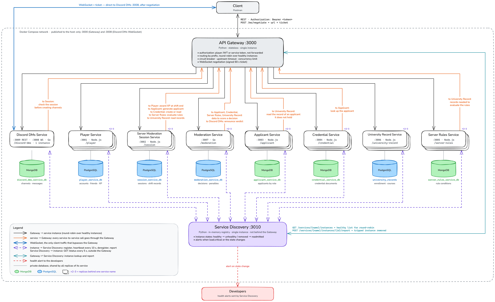

# Student ID, Please — PAD Project (Topic 3)

Team 18

## Table of Contents

- [Overview](#overview)
- [Team](#team)
- [Service Boundaries](#service-boundaries)
- [Architecture Diagram](#architecture-diagram)
- [Tech Stack & Communication Patterns](#tech-stack--communication-patterns)
- [Communication Contract](#communication-contract)
- [Logging Convention](#logging-convention)
- [Development Guidelines](#development-guidelines)
- [Microservice Repositories](#microservice-repositories)
- [Docker Images](#docker-images)
- [Running the Stack](#running-the-stack)
- [Project Board](#project-board)

## Overview

A Discord-server-moderation game: applicants (students, professors, alumni, outsiders — some presenting false credentials) attempt to join the university server each round. A moderation team of players must consult university records, verify credentials, check current server rules, and communicate findings before deciding to Accept, Reject, Flag, or Ban.

## Team

| Name | Group | Service 1 | Service 2 |
|---|---|---|---|
| [Mihaela Untu](https://github.com/mihaelaaa-23) | FAF-232 | Player Service | Server Moderation Session Service |
| [Ciprian Moisenco](https://github.com/ciprik13) | FAF-232 | Applicant Service | Credential Service |
| [Ion Iamandii](https://github.com/ion190) | FAF-233 | Server Rules Service | University Record Service |
| [Liviu Chirtoaca](https://github.com/D3adeYe69) | FAF-233 | Moderation Service | Discord DMs Service |

The **Gateway** (added in Lab 2) is owned by [Mihaela Untu](https://github.com/mihaelaaa-23).


## Service Boundaries

> One subsection per service. Each should describe what it owns, what it manages, and what it deliberately does NOT own.

### Player Service

Responsible for the identity and progression of the players who take part in moderation shifts. It owns player accounts, authentication credentials, and public profiles (moderator handle, avatar), along with the player's friends list used to team up before a shift. It also owns XP and leveling — players gain experience from completed shifts, correct decisions, and any disciplinary actions taken against them, and level up over time based on this history.

**Database:** PostgreSQL (`player_service_db`) — player accounts, credentials, and XP/level history are relational and benefit from foreign-key integrity between players and their friends list.

Player Service does **not** own any moderation-session state (that belongs to Server Moderation Session Service), nor any information about the applicants trying to join the Discord server (owned by Applicant Service). It communicates with Server Moderation Session Service to let players join available sessions and receives shift results at the end of each session to update XP and levels accordingly.

### Server Moderation Session Service

Owns the lifecycle of an active moderation shift — one Moderator plus several Junior Moderators working a shift together. It is responsible for creating and joining sessions, assigning the Moderator/Junior Moderator roles, and starting/ending shifts. It tracks the current applicant being reviewed, how many applications have been processed so far, and a running session score with any penalties incurred during the shift. At the end of a shift, it determines the overall session result and publishes it so Player Service can update player progression.

**Database:** PostgreSQL (`session_service_db`) — session/shift records are structured and short-lived, with clear relational links between a session, its participants, and its running score.

This service does **not** store any persistent player data (accounts, XP, friends — that's Player Service), nor does it own applicant, credential, or rule data. It coordinates a shift by pulling in information from Applicant Service, Credential Service, Server Rules Service, and University Record Service as each applicant comes through.

### Applicant Service

Owns the people attempting to access the Discord server. It generates applicants with attributes such as name, student ID, major, year, university status, courses, and role (FAF student, student of another faculty, teaching assistant, staff, alumnus, or outsider). Some applicants are deliberately generated with false information or as impersonation attempts. If it's the first service contacted for a new applicant, it initializes that applicant's profile and propagates the relevant data to Credential Service and University Record Service; otherwise, it builds its own record from whichever service initialized the applicant first.

**Database:** MongoDB (`applicant_service_db`) — applicant profiles vary in shape by role (student vs. outsider vs. alumnus), which suits a flexible document schema better than a fixed relational one.

It does **not** own credential documents (Credential Service) or hidden university records (University Record Service), and it does **not** decide whether an applicant is admitted (Moderation Service).

### Credential Service

Owns the documents and credentials an applicant presents — student ID, university email, enrollment confirmation, course registration, and similar. Credentials can be expired, forged, inconsistent, or incomplete. It validates the structure and authenticity of what's presented, but it does not decide whether the applicant should be let in. Like Applicant Service, whichever of the two is contacted first for a new applicant initializes the shared data and propagates it to the other.

**Database:** MongoDB (`credential_service_db`) — credential documents differ by type (ID card, email confirmation, enrollment letter) and are naturally stored as loosely-structured documents rather than fixed columns.

It does **not** own the applicant's general profile (Applicant Service) or the actual admission decision (Moderation Service).

### Server Rules Service

Owns the current access rules for the Discord server — rules that can change between shifts and grow arbitrarily complex (e.g. "only FAF students may join," "first-years can't access certain channels," "previously banned students are never re-admitted"). Its core job is evaluating a given applicant against whatever the current rule set is.

**Database:** MongoDB (`server_rules_service_db`) — rules are arbitrarily nested conditions that don't map cleanly to fixed columns, so a document store keeps rule definitions flexible as they grow more complex.

It does **not** store applicant data itself (Applicant Service), university records (University Record Service), or make the final Accept/Reject/Flag/Ban call (Moderation Service) — it only reports whether an applicant passes or fails the current rules.

### University Record Service

Owns the hidden university information moderators may need to verify an applicant: enrollment lists, Outlook group/email lists, current course catalog, academic year, and semester schedule. This information is deliberately fragmented across Junior Moderator players — one might see the enrollment list, another the message records — and the service must enforce that players can't access records they weren't assigned to see. As with Applicant/Credential Service, whichever service is contacted first for a new applicant initializes the record and propagates it onward.

**Database:** PostgreSQL (`university_records`) — enrollment lists, course catalogs, and semester schedules are inherently relational (students ↔ courses ↔ semesters), and per-field access scoping is easier to enforce with relational constraints.

It does **not** own the applicant's public profile (Applicant Service) or credentials (Credential Service), and it does not enforce server rules itself (Server Rules Service).

### Moderation Service
Owns the actual admission decision for each applicant. The Moderator chooses Accept, Reject, Flag (for further investigation), or Ban, and the service gathers the relevant information from Applicant, Credential, Server Rules, and University Record Services to determine whether the decision was correct under the current rules. It records the applicant, the decision made, any rules violated, penalties applied, and the outcome.

**Database:** PostgreSQL (`moderation_service_db`) — decisions, violated rules, and penalties form a clean relational audit trail tying each decision back to a specific applicant and session.

It does **not** generate or store applicant/credential/record data itself, and it does not handle the real-time communication between players (Discord DMs Service) — it only consumes information and produces a verdict.

### Discord DMs Service

Provides real-time communication between the Moderator and Junior Moderators during a session, through a Discord-like WebSocket interface. It manages channels tied to the current moderation session (e.g. #enrollment-check, #faculty-check, #course-registration, #general-mod-chat), with different players able to access different channels depending on what information they've been assigned.

**Database:** MongoDB (`discord_dms_service_db`) — chat messages and per-session channel membership are naturally document-shaped and high-write, which fits MongoDB's model better than a fixed relational schema.

It transports messages but does **not** determine whether the information shared is correct, and it does not own any applicant, credential, or rule data itself — it's purely the communication layer.

### Gateway

The single entry point of the system, added in Lab 2. Every REST request — from the client and between services — goes through the Gateway, which forwards it to the service that owns the resource. It also owns the concerns that belong at the edge: validating the `Authorization` header (and not forwarding it downstream), negotiating WebSocket connections by giving the client a URL to connect to Discord DMs Service directly, and enforcing its own task timeout and concurrent task limit.

**Database:** none. The Gateway is stateless and holds no business data.

It does **not** own any player, session, applicant, credential, rule, record, decision, or message data, and it does not make business decisions (admission, rule evaluation, scoring) — those stay with the services behind it. It also does not carry WebSocket traffic: once a connection is negotiated, the client talks to Discord DMs Service directly.

## Architecture Diagram



The Client reaches the system only through the **API Gateway** (`:3000`, Python, one instance). It sends every REST request with `Authorization: Bearer <token>`; the Gateway validates the token, does not forward it, takes the healthy instances of the target service from **Service Discovery** and forwards the request to one of them in round-robin order. The black arrows are these forwarded requests, one per service; each service box shows its port, language and route prefix.

Services never call each other directly. Every service-to-service call goes back out through the Gateway (orange arrows), which forwards it like any other request; each orange label names the target service and what the call is for. The only traffic that bypasses the Gateway is the Discord DMs WebSocket (blue): the Client first gets a URL and a signed 60-second ticket from `POST /ws/negotiate`, then connects to Discord DMs on `:3008` directly.

Every service except Discord DMs runs as 2–3 replicas (stacked boxes) behind one service name, and all replicas of a service share its private database (green: MongoDB, blue: PostgreSQL), labelled with the database name and what it stores. Discord DMs runs as one instance, because `:3008` is published to the host and a message sent to one replica would not reach sockets connected to another.

**Service Discovery** (`:3010`, Python, one instance, in-memory registry) is the one REST exception to "everything goes through the Gateway", because the Gateway depends on it. Each instance registers on startup, sends a heartbeat every 10 s, deregisters on shutdown and reports an instance whose circuit breaker tripped; Service Discovery calls every instance's `/status` every 5 s (purple, dashed). The Gateway reads the healthy instances from it and reports tripped instances to it (teal). When an instance changes state or its load becomes critical, Service Discovery alerts the developers (red, dashed).

Only the Gateway (`:3000`) and the Discord DMs WebSocket (`:3008`) are published to the host; everything else stays inside the Docker Compose network.

**Service Relationships**

Every relationship below is a REST call sent through the Gateway, which forwards it to a healthy instance of the target service.

- **Server Moderation Session Service** coordinates a shift. For each applicant it asks Applicant Service to generate the applicant, Credential Service to create or read its credential, Server Rules Service to evaluate the rules and University Record Service for the applicant's records. When the shift ends, it sends the earned XP to Player Service.
- **Moderation Service** gathers data from Applicant, Credential, Server Rules and University Record to score the Moderator's decision (Accept, Reject, Flag or Ban), and announces the verdict through Discord DMs Service.
- **Discord DMs Service** checks a session against Server Moderation Session Service before creating its channels and roster.
- **Applicant Service** reads from University Record Service the record of an applicant it does not hold.
- **Credential Service** looks up the applicant in Applicant Service.
- **Server Rules Service** reads from University Record Service the records it needs to evaluate the rules.
- **Player Service** and **University Record Service** call no other service.
- Applicant, Credential and University Record Service are meant to create each other's records for a new applicant (mutual initialization, see Data Management Across Microservices); no service does this yet, so the diagram does not show it.

## Tech Stack & Communication Patterns

> Languages used by the team: **Node.js** + **Go** for the 8 services, and **Python** for the Gateway. Python is our team's "banned language" (a language known by everyone on the team), so it is excluded from all 8 private microservices per the assignment rules. Lab 2 requires the Gateway to be written in the banned language, which makes it the one Python service.

**Node.js**

Used for Player Service, Server Moderation Session Service, Applicant Service, Credential Service, Server Rules Service, and University Record Service. These are CRUD and validation-heavy with no real concurrency needs. Node's flexible object handling fits the loosely-shaped JSON these services pass around, and Express keeps boilerplate low as rules and applicant types keep expanding.

**Go**

Used for Moderation Service and Discord DMs Service. Moderation Service calls four other services per decision and must stay responsive under concurrent sessions — goroutines handle that fan-out cheaply. Discord DMs Service keeps many per-channel WebSocket connections open per shift; Go's goroutine-per-connection model is built for exactly that.

**Python**

Used only for the Gateway, as Lab 2 requires. Its framework and libraries are documented in the Gateway's own README.

**Databases**

Following the database-per-service rule below, each service picked PostgreSQL or MongoDB based on how structured its own data is, not by matching its language:

| Service | Database | Why |
|---|---|---|
| Player Service | PostgreSQL | Relational links between accounts, friends, XP history |
| Server Moderation Session Service | PostgreSQL | Structured, short-lived session/shift records |
| University Record Service | PostgreSQL | Relational enrollment/course/semester data with field-level access scoping |
| Moderation Service | PostgreSQL | Relational audit trail of decisions and penalties |
| Applicant Service | MongoDB | Applicant shape varies by role (student/alumnus/outsider) |
| Credential Service | MongoDB | Credential documents vary by type |
| Server Rules Service | MongoDB | Arbitrarily nested rule conditions |
| Discord DMs Service | MongoDB | High-write, document-shaped chat messages |

The Gateway has no database (see its Service Boundaries entry).

## Communication Contract
 
### Data Management Across Microservices

We use **database-per-service**, not a shared database: each of the 8 services owns one private database (see the **Databases** table above), and no service ever connects to another service's database directly — not even read-only. All cross-service data access is mediated through the owning service's REST API, using the request/response shapes defined in the Endpoints tables below.

This has a few direct consequences for how the system behaves:

- **No shared schema.** Applicant, Credential, and University Record Service each store only the fields relevant to their own concern (profile data, documents, hidden records respectively) rather than one team owning a combined "applicant" table others read from. This is why Server Rules Service can't just query enrollment data directly — it has to ask University Record Service for it over the network.
- **Mutual initialization instead of a single source of truth.** Applicant, Credential, and University Record Service can each be the *first* service contacted about a new applicant. Whichever one is first creates that applicant's record and pushes the relevant subset of data to the other two over their APIs. This avoids a single owning service becoming a bottleneck, at the cost of each of the three needing to handle "applicant already exists, sync my copy" as a real code path — not just "create new."
- **Status in Lab 1:** mutual initialization is the target design, not current behaviour. No service propagates records yet, so an applicant generated by Applicant Service exists only there, and University Record Service answers `404` for it (no record exists). Applicant Service only *reads* from University Record Service (on `GET /applicants/{id}` for an applicant it doesn't hold).
- **Read-heavy orchestration, not a shared cache.** Session Service and Moderation Service don't hold their own copies of applicant/credential/rule/record data — every shift and every decision re-queries the four data services live. We're intentionally trading a bit of latency for never having stale applicant data during a shift.
- **Eventual, not transactional, consistency.** Because propagation between Applicant/Credential/University Record happens as separate API calls rather than a single database transaction, it's possible for one of the three to succeed and another to fail or lag. For Lab 1 we're accepting this risk rather than introducing a message broker; if this becomes a real problem in testing, promoting the mutual-init calls to an event-driven pattern is the natural next step, but it's out of scope for now.
- **Credentials never travel in the diagram or the repo.** Each service's Docker setup expects DB connection details via environment variables (see each service's own README), and none of those values are committed — only `.env.example` placeholders.
 
### Endpoints
 
#### Gateway

The single entry point of the system (Lab 2). Clients call `http://localhost:3000/<prefix>/<service path>`; the Gateway strips the prefix, forwards the request to a healthy instance of the service that owns it, and returns that service's status and body unchanged. Response headers pass through too, except hop-by-hop headers and `Content-Length`, `Content-Encoding`, `Date` and `Server`, which the Gateway sets itself; it also adds `X-Request-Id` and `X-Instance-Id`.

| Prefix | Service | Service Discovery name | Fixed upstream while `SERVICE_DISCOVERY_URL` is unset (env var) |
|---|---|---|---|
| `/player` | Player Service | `player-service` | `http://player-service:3001` (`PLAYER_SERVICE_URL`) |
| `/session` | Server Moderation Session Service | `session-service` | `http://session-service:3002` (`SESSION_SERVICE_URL`) |
| `/applicant` | Applicant Service | `applicant-service` | `http://applicant-service:3003` (`APPLICANT_SERVICE_URL`) |
| `/credential` | Credential Service | `credential-service` | `http://credential-service:3004` (`CREDENTIAL_SERVICE_URL`) |
| `/server-rules` | Server Rules Service | `server-rules-service` | `http://server-rules-service:3005` (`RULES_SERVICE_URL`) |
| `/university-record` | University Record Service | `university-record-service` | `http://university-record-service:3006` (`UNIVERSITY_RECORD_SERVICE_URL`) |
| `/moderation` | Moderation Service | `moderation-service` | `http://moderation-service:3007` (`MODERATION_SERVICE_URL`) |
| `/discord-dms` | Discord DMs Service | `discord-dms-service` | `http://discord-dms-service:3009` (`DISCORD_DMS_SERVICE_URL`) — its REST port; `3008` serves only the WebSocket |

| Method | Path | Request | Response |
|---|---|---|---|
| GET | /status | — | `{service: "gateway", status: string, time: string, load: load}` |
| POST | /ws/negotiate | `{sessionId: string, channel: string, playerId?: string}` | `{url: string, ticket: string, expiresAt: string}` |
| any | /{prefix}/{service path} | forwarded unchanged | the service's response, unchanged |

Notes for callers:

- Example: `GET /applicant/applicants/42` is forwarded as `GET /applicants/42` to Applicant Service. `GET /status` is the Gateway's own; a service's status is `/<prefix>/status`.
- `Authorization` is never forwarded to a service. Client-sent `X-Player-Id`, `X-Caller-*`, `Forwarded` and `X-Forwarded-*` headers are removed — only the Gateway sets them (`X-Player-Id` / `X-Caller-*` after authorization), so services can trust them.
- Authorization (Lab 2, grade 10). The Gateway is the only place a token is checked; services never see `Authorization` and trust the headers the Gateway sets.
  - **Public routes**, no token needed: `GET /status`, `GET /<prefix>/status`, `POST /player/players/register` and `POST /player/players/login`. Every other request needs `Authorization: Bearer <token>`.
  - **A player token** is the `token` returned by `POST /player/players/login`: a JWT signed with HS256 and `JWT_SECRET`, which only Player Service (signs) and the Gateway (verifies) hold. Claims: `sub` (the `playerId`), `iss` (`"player-service"`), `iat` and `exp` (Unix seconds; `exp` is 24 hours after `iat`). The Gateway checks the signature, `iss` and `exp`, then forwards the request with `X-Player-Id: <sub>` and `X-Caller-Type: player`. It accepts only `HS256` and rejects any other `alg`, including `none`, rather than taking the algorithm from the token header. `exp` is accepted up to 5 seconds late, for clock skew between containers. `JWT_SECRET` is at least 32 characters.
  - **A service token** is for service-to-service calls, which also go through the Gateway and carry no player. It is one shared secret, `SERVICE_TOKEN`, set from `.env` on the Gateway and on every service; a service sends it as `Authorization: Bearer <SERVICE_TOKEN>` on every outgoing call. The Gateway forwards such a request with `X-Caller-Type: service` and no `X-Player-Id`. A service call therefore carries no verified player: a player id passed inside the request itself (for example University Record's `requestingPlayerId`) is still whatever the calling service sent.
  - Anything else (no header, a scheme other than `Bearer`, a malformed, wrongly signed or expired token, another issuer) is answered `401 UNAUTHORIZED` with `WWW-Authenticate: Bearer` and is not forwarded. The `401` is decided before the request takes one of the Gateway's concurrency slots, so requests without a token cannot fill them. For a calling service that is a refused lookup (a configuration error, `502 DEPENDENCY_REFUSED`), never a reason to fall back to a mock.
  - The Gateway authenticates; it does not decide what a caller may do. A service that needs to (for example "only the author may delete this message") uses `X-Player-Id` and `X-Caller-Type`, which a client cannot forge because the Gateway removes client-sent copies.
  - Rollout: while `JWT_SECRET` is unset on the Gateway nothing is enforced and requests pass as before, so Player Service, the other services and the Postman collections can adopt this independently. `JWT_SECRET` and `SERVICE_TOKEN` are set together: the Gateway refuses to start when only one of them is set, and logs a warning at startup when neither is, so a stack without authentication is never silent. In the shared stack both are set, and `docker compose` refuses to start without them. They must be two different values (the Gateway refuses to start when they are equal), so a leaked service token cannot be used to sign a player token. Every Postman collection then registers and logs in a player through the Gateway first and sends that token on its requests.
- Every forwarded request carries `X-Request-Id` (kept if the client sent one, otherwise generated, and returned in the response), plus `X-Forwarded-Prefix` and `X-Forwarded-For`.
- The Gateway waits `UPSTREAM_TIMEOUT_MS` (default `10000`) for a service before giving up, or less on a service call that sends `X-Timeout-Ms` (below).
- **Routing to instances (Lab 3).** The Gateway takes the instances of each service from Service Discovery (`GET /services`, every `SD_REFRESH_MS`, default `2000`) and keeps only those in state `healthy`. Requests to one prefix go to its healthy instances in turn (round-robin, in `instanceId` order). If Service Discovery cannot be reached, the Gateway keeps routing with the last list it received and logs a warning; if it has no healthy instance for a service, it answers `502 BAD_GATEWAY` without `X-Instance-Id`. A service Service Discovery does not currently list, in any state, has not moved to Service Discovery yet (its image does not register) or has no instance registered right now, so it keeps its fixed upstream from the table above and gets no `X-Instance-Id`; the Gateway logs that at `WARN`, once each time a service falls back, so a service whose registration is refused does not go unnoticed. As soon as one of its instances is listed, only its healthy instances are used, so services move to Service Discovery one at a time without breaking the others. While `SERVICE_DISCOVERY_URL` is unset, the Gateway uses the fixed upstreams in the table above, as in Lab 2. The Gateway registers itself in Service Discovery as `gateway` with `statusPath` `/status` and behaves like every instance: it sends a heartbeat every `SD_HEARTBEAT_MS`, registers again when a heartbeat answers `404`, and deregisters on shutdown, so it is health-polled and never evicted while it runs. It fetches the list at startup and on every refresh. In compose the Gateway only waits for Service Discovery to start, not to be healthy: until the list arrives, and whenever Service Discovery is down with no list received yet, every service is reached at its fixed upstream, so the stack stays reachable without Service Discovery. A listed service with no healthy instance gets `502 BAD_GATEWAY` without `X-Instance-Id`.
- **`X-Instance-Id`.** Every forwarded response carries the `instanceId` of the instance that answered; the Gateway sets it and replaces any value the service sent. Its own `502 BAD_GATEWAY` and `504 GATEWAY_TIMEOUT` for an instance carry that instance's id too. Every other answer the Gateway gives itself (`401`, `403`, `404 ROUTE_NOT_FOUND`, `503`, and `502` with no healthy instance) has none. A caller's circuit breaker counts failures per `X-Instance-Id` (see Circuit Breaker). While `SERVICE_DISCOVERY_URL` is unset, the Gateway knows no instances and forwarded responses carry no `X-Instance-Id`, so callers count every failure per callee, as before Lab 3.
- **`X-Timeout-Ms`.** A service sends its `HTTP_TIMEOUT_MS` as `X-Timeout-Ms` on every outgoing call. On a call made with the service token, the Gateway gives up on the instance after `X-Timeout-Ms − 200` ms (never later than `UPSTREAM_TIMEOUT_MS`) and answers `504 GATEWAY_TIMEOUT` with the instance's `X-Instance-Id`, so a replica that never answers is counted against itself. A value that is not an integer above `200` is ignored. On any other call the header is removed and `UPSTREAM_TIMEOUT_MS` applies, so a client cannot shorten timeouts and make healthy instances look broken. The header is never forwarded to the service.
- **The Gateway's own circuit breaker (Lab 3, grades 7 and 10)** follows the shared rules in Circuit Breaker, per instance, with a window of `UPSTREAM_TIMEOUT_MS × 3.5` (`35000`). It counts a timeout only when its own `UPSTREAM_TIMEOUT_MS` ran out; a `504` given because of a caller's `X-Timeout-Ms` is counted by that caller alone. In `BREAKER_MODE=remove` it reports the instance to Service Discovery with `reporter` `gateway` and stops routing to it at once, without waiting for the next refresh.
- Timeout budget of the shared stack (Lab 2, grade 8). A caller must never give up on work the callee is still doing, so on every hop the caller's outgoing call timeout is larger than the callee's `TASK_TIMEOUT_MS`, and a service's own `TASK_TIMEOUT_MS` is larger than its outgoing call timeout. Values are what `docker-compose.yml` sets; an image run without them falls back to its own defaults.

  | Service | Outgoing call timeout | `TASK_TIMEOUT_MS` |
  |---|---|---|
  | Player, University Record (leaves) | — | `2000` |
  | Server Rules | `2500` (to University Record) | `3000` |
  | Applicant | `2500` (to University Record) | `3000` |
  | Credential | `3500` (to Applicant) | `4000` |
  | Server Moderation Session | `4500` per call | `8000` |
  | Moderation | `4500` per call | `8000` |
  | Discord DMs, REST | `8500` (to Session) | `9000` |
  | Gateway | `10000` (`UPSTREAM_TIMEOUT_MS`) | — |

  One hop is deliberately outside this rule. Moderation's call to Discord DMs, which announces a verdict in chat, is bounded by `3000` rather than by Discord DMs' `9000` cap. It is best-effort: the decision is already stored by the time it runs, a failure only reports `announcedInChat: false`, and nothing is retried, so giving up early costs an announcement rather than a decision. Worth knowing: giving up does not undo work already done. Discord DMs stores a message before broadcasting it, so a verdict reported as not announced may still have reached the channel.

  `TASK_TIMEOUT_MS` is a cap, not a sum: Session and Moderation make several calls per request, so two slow dependencies can use up `8000` and the service answers `504 TASK_TIMEOUT` itself. The Gateway's `10000` stays above every service's cap, so a client sees the service's own `504 TASK_TIMEOUT` rather than `504 GATEWAY_TIMEOUT`. Services that do not implement grade 8 yet adopt their row when they do.
- Errors produced by the Gateway itself use the shared envelope:

  | Status | Code | When |
  |---|---|---|
  | `401` | `UNAUTHORIZED` | a non-public route was called without a valid `Authorization: Bearer` token (missing, malformed, wrongly signed, expired, or another issuer); sent with `WWW-Authenticate: Bearer`, the request is not forwarded |
  | `403` | `FORBIDDEN` | `POST /ws/negotiate` was called with the service token: a service has no player to issue a ticket for. This is the one route the Gateway answers itself, so it is the only place the Gateway produces this code; a `403` on a forwarded route is the service's own |
  | `404` | `ROUTE_NOT_FOUND` | the first path segment is not a known prefix |
  | `502` | `BAD_GATEWAY` | the instance is unreachable (with its `X-Instance-Id`), or Service Discovery lists no healthy instance of the service (without one) |
  | `503` | `CONCURRENCY_LIMIT_REACHED` | `MAX_CONCURRENT_TASKS` requests are already in progress; sent with `Retry-After: 1`, the request is not forwarded |
  | `503` | `WS_NEGOTIATION_DISABLED` | `POST /ws/negotiate` was called while `WS_TICKET_SECRET` is unset. Unlike `CONCURRENCY_LIMIT_REACHED`, retrying never helps: it is a configuration state, not load. Like the pair on `502`, the two `503`s are told apart by their code |
  | `504` | `GATEWAY_TIMEOUT` | the instance did not answer within `UPSTREAM_TIMEOUT_MS`, or within `X-Timeout-Ms − 200` on a service call; carries the instance's `X-Instance-Id` |

  The Gateway never produces `503 DEPENDENCY_UNAVAILABLE`: that code is a service saying one of its own dependencies is unavailable, and it passes through unchanged like every other service error.

  Errors produced by a service (e.g. its `404 NOT_FOUND` for a missing resource) pass through unchanged, so `ROUTE_NOT_FOUND` always means a wrong prefix, never a missing resource.

  Concurrent task limit (Lab 2, grade 8): every forwarded request holds one slot until the service has answered, and that includes service-to-service calls, which also go through the Gateway. One client request therefore holds several slots at once: one per hop in progress, nested hops included. During `process-applicant` that peaks at about 7 (Session's own request plus Credential → Applicant → University Record and Server Rules → University Record, each hop holding its own slot), about 8 when the request comes in through Discord DMs. So the Gateway's limit must be far above a single service's `MAX_CONCURRENT_TASKS` (`50`), or the outer requests would fill the slots and the inner calls of the same requests would be refused. The variable is `MAX_CONCURRENT_TASKS` in the Gateway image (default `500`), set in compose from `GATEWAY_MAX_CONCURRENT_TASKS`, next to `GATEWAY_UPSTREAM_TIMEOUT_MS`. Rule: Gateway limit ≥ a service's limit × the hops one client request holds at once, with margin; here 50 × 8 = 400 < 500. `/status` is exempt, so the healthcheck keeps answering under load. The Gateway has no task timeout of its own: `UPSTREAM_TIMEOUT_MS` already bounds every forwarded request. A `503 CONCURRENCY_LIMIT_REACHED` from the Gateway and one from a service mean the same thing for a caller (overloaded, retry later), so they share the code. A Gateway `503` on an inner hop reaches the calling service as an ordinary `5xx`, so that service answers `503 DEPENDENCY_UNAVAILABLE` (see Circuit Breaker); it is not a `DEPENDENCY_REFUSED`, and it is not counted by the breaker, because a busy instance is not a broken one.

  Besides these, the Gateway answers `404 NOT_FOUND` for a path with no service prefix at all (e.g. `GET /`) and `500 INTERNAL_ERROR` for an unexpected error of its own.
- The Discord DMs WebSocket is not proxied: clients connect to it directly after negotiating with the Gateway. A long-lived socket proxied through the Gateway would hold one of its slots for a whole shift, so the Gateway authorises the connection up front and then steps out of the way.

  **Negotiating a socket.** `POST /ws/negotiate` with `{sessionId, channel}` answers `{url, ticket, expiresAt}`. A missing or empty `sessionId` or `channel` is `422 VALIDATION_FAILED`, as everywhere else in this contract. The call is an ordinary request through the Gateway, so it counts against `MAX_CONCURRENT_TASKS` like any other; only the socket it authorises stays outside. The client then opens `<url>?ticket=<ticket>`, which is a direct connection to Discord DMs Service on its published WebSocket port. `url` is the address the *client* can reach, from the Gateway's `DISCORD_DMS_WS_PUBLIC_URL` (in the shared stack `ws://localhost:3008`) — not the in-network name, which a client outside the compose network cannot resolve.

  **The ticket** is `<payload>.<signature>`, both base64url without padding:

  - `payload` is the JSON `{"sessionId": string, "channel": string, "playerId": string, "exp": int}`, where `exp` is a Unix timestamp in seconds, 60 seconds after issue.
  - `signature` is `HMAC-SHA256(payload, WS_TICKET_SECRET)` over the base64url payload text exactly as it appears in the ticket, so both sides sign the same bytes without re-serialising the JSON.
  - `WS_TICKET_SECRET` is shared by the Gateway and Discord DMs Service through the environment and is never sent to a client.

  **The player comes from the validated token**, never from the request body. `/ws/negotiate` is a protected route like any other: it needs a player token, and the ticket is issued for that token's `sub`, the same value the Gateway forwards as `X-Player-Id`. A `playerId` in the body is optional and ignored, so nobody can ask for a ticket in another player's name, and the ticket proves who is connecting. The service token is answered `403 FORBIDDEN`: a service has no player to put in a ticket.

  While the Gateway's authorisation is off (`JWT_SECRET` unset, the rollout state described above), nobody is authenticated. Only then is `playerId` read from the body, where it is required (`422 VALIDATION_FAILED` when missing or empty), and a ticket proves only that the request went through the Gateway, not who sent it.

  **A ticket is bound to one channel.** Discord DMs rejects it unless `sessionId`, `channel` and `playerId` all match the connection being opened, so a ticket for `#general-mod-chat` cannot open `#faculty-check`. A client opening several channels negotiates once per channel.

  **Discord DMs answers `401 UNAUTHORIZED`** when the ticket is missing, malformed, signed with another secret, expired, or issued for a different session, channel or player. That answer is the HTTP response to the upgrade handshake, so it arrives before any socket is opened. Once the ticket is accepted, the channel-access rules apply unchanged: a player who was never assigned the channel still gets `403 FORBIDDEN`. The ticket settles *who is connecting*; the roster still settles *what they may read*.

  **A ticket may be used more than once** inside its 60 seconds. It is not a nonce, and nothing tracks which tickets have been spent: the short life is what bounds the damage of a leaked one. The signature is compared in constant time, and `exp` is allowed a few seconds of leeway so a small clock difference between containers does not refuse a ticket that was just issued.

  **While `WS_TICKET_SECRET` is unset**, Discord DMs keeps accepting `?playerId=` as before and the Gateway answers `503 WS_NEGOTIATION_DISABLED`. That is the state before this is rolled out, so the two services can ship their halves independently. Because that fallback is silent from the outside, Discord DMs logs a warning at startup when the secret is missing, and the shared `docker-compose.yml` sets it on both services from `.env` — a forgotten secret should be visible, not merely permissive.

#### Service Discovery

The registry of running service instances (Lab 3). Every instance registers itself on startup, sends heartbeats while it runs and deregisters on shutdown; Service Discovery also polls each instance's `/status` on an interval. The Gateway reads the list of healthy instances from it to choose where to forward a request, so instances can be added and removed without changing any configuration.

Service Discovery is internal infrastructure: it listens on `3010` inside the compose network (`http://service-discovery:3010`, `SERVICE_DISCOVERY_URL`), is not published to the host and is **not reached through the Gateway**. That is the one exception to "all REST traffic goes through the Gateway", and it is forced: the Gateway needs Service Discovery to find any service, so registration cannot depend on the Gateway being up. It runs as a single instance and has no database.

| Method | Path | Request | Response |
|---|---|---|---|
| POST | /services/register | `{serviceName: string, instanceId: string, url: string, statusPath?: string}` | `201` new, `200` already registered + `{serviceName: string, instanceId: string, url: string, state: string, registeredAt: string}` |
| PUT | /services/{serviceName}/instances/{instanceId}/heartbeat | — | `200` + `{serviceName: string, instanceId: string, state: string, lastSeen: string}`; `404 NOT_FOUND` if the instance is not registered |
| DELETE | /services/{serviceName}/instances/{instanceId} | — | `204`; `404 NOT_FOUND` if the instance is not registered |
| POST | /services/{serviceName}/instances/{instanceId}/report | `{reporter: string, reason: string}` | `202` + `{serviceName: string, instanceId: string, state: string}`; `404 NOT_FOUND` if the instance is not registered |
| GET | /services/{serviceName}/instances | `?includeUnhealthy=boolean` (default `false`) | `{serviceName: string, instances: [instance]}` |
| GET | /services | — | `{services: {<serviceName>: [instance]}}` — every instance in every state |
| GET | /health | — | `{status: "ok"}` |
| GET | /status | — | `{service: "service-discovery", status: string, time: string, instances: int}` |

`instance` is `{serviceName: string, instanceId: string, url: string, state: string, load: object|null, lastSeen: string|null, registeredAt: string}`.

Notes for callers:

- **Fields.** `serviceName` is the compose service name (`applicant-service`, `gateway`, …), the same value services write as `service` in their logs. `instanceId` identifies one running instance and is the same value the instance writes as `instanceId` in its logs. `url` is `http://<container hostname>:<port>`: the container hostname is unique per container, resolves inside the compose network, and is the same hostname `instanceId` is built from. With replicas the compose service name resolves to any of them, so it cannot be used here. `ADVERTISE_URL` overrides `url`; it is only for a single instance run outside compose and must not be set on a scaled service, because replicas sharing one `url` would keep replacing each other in the registry. Each instance registers the port that serves its REST endpoints and `statusPath`: Discord DMs registers `3009`, not its WebSocket port `3008`. `statusPath` defaults to `/status`. Timestamps are ISO 8601 UTC with milliseconds.
- **Authorization.** Every write (`register`, `heartbeat`, `DELETE`, `report`) needs `Authorization: Bearer <SERVICE_TOKEN>`, the same shared service token as in Lab 2; anything else is `401 UNAUTHORIZED` with `WWW-Authenticate: Bearer`. Service Discovery refuses to start when `SERVICE_TOKEN` is unset, since compose always sets it. Reads are open inside the compose network. A registry anyone could write to would let any container redirect traffic to itself.
- **Registering.** An instance registers once its HTTP server is listening. If Service Discovery is not reachable yet or answers `5xx`, it retries with exponential backoff (1 s, 2 s, 4 s, … capped at 30 s) and keeps serving meanwhile. A `401` or `422` is a configuration error, not a transient one: the instance logs it at `ERROR` and stops retrying. Registering is idempotent: registering the same `serviceName` + `instanceId` again answers `200`, updates `url` and `statusPath`, and does not change the instance's state. Registering removes any other instance of the same service with the same `url`, which can only be a leftover of a container that stopped without deregistering.
- **Heartbeats.** Each instance sends a heartbeat every `SD_HEARTBEAT_MS` (default `10000`). A `404` means Service Discovery does not know the instance (it restarted and lost its in-memory registry), so the instance registers again. The registry is soft state: after a restart of Service Discovery it fills up again within one heartbeat interval.
- **Deregistering.** On `SIGTERM` or `SIGINT` an instance sends `DELETE` with a short timeout, best effort, then stops. `docker compose stop` and scaling down therefore remove instances immediately.
- **Health polling.** Every `HEALTH_INTERVAL_MS` (default `5000`) Service Discovery calls each registered instance's `statusPath` directly, with a timeout of `HEALTH_TIMEOUT_MS` (default `1000`). These calls do not go through the Gateway and carry no token and no `X-Caller-*` headers, so every service keeps `statusPath` outside its caller-header checks, its task timeout and its concurrency limit; otherwise a loaded instance would answer the poll with `503 CONCURRENCY_LIMIT_REACHED` and leave rotation exactly when it is needed. A poll succeeds when the instance answers `200`; the `load` object from that response is stored as the instance's `load`. `lastSeen` is the time of the last successful poll or heartbeat. Every service that registers must expose `statusPath`; one without it turns `unhealthy` after three polls.
- **States.**

  | State | Meaning | Returned by `GET /services/{name}/instances` |
  |---|---|---|
  | `healthy` | registered and answering | yes |
  | `unhealthy` | `HEALTH_FAILURES_TO_UNHEALTHY` (default `3`) polls in a row failed | only with `includeUnhealthy=true` |
  | `removed` | a caller's circuit breaker reported it (`report`) | only with `includeUnhealthy=true` |

  A new instance starts `healthy`. An `unhealthy` instance is still polled and is `healthy` again after `HEALTH_SUCCESSES_TO_READMIT` (default `3`) successful polls in a row. A `removed` instance is readmitted the same way, but only after it has spent at least `REMOVED_MIN_MS` (default `30000`) in `removed`: `/status` only shows that the instance and its database answer, not that its real endpoints work, so without that minimum an instance whose endpoints keep failing would come back within seconds, trip the breakers again and send two alerts per round. A restarted container rejoins without any manual step. An instance with no successful poll and no heartbeat for `EVICT_AFTER_MS` (default `60000`) is deleted from the registry, which cleans up containers that were killed without deregistering.
- **Load reporting (Lab 3, grade 8).** Every task-controlled service that registers with Service Discovery reports the same `load` object in its `/status` response: `{inFlight: int, maxConcurrent: int, percent: int, critical: boolean}`. `inFlight` is the number of requests currently counted by the service's task-control middleware; `maxConcurrent` is `MAX_CONCURRENT_TASKS`; `percent` is the rounded integer percentage of capacity in use. `critical` is computed from the exact ratio, not the rounded percentage: `inFlight * 100 >= LOAD_CRITICAL_PERCENT * maxConcurrent`. `LOAD_CRITICAL_PERCENT` defaults to `80`; valid values are integers from `1` to `100`, and invalid values fall back to `80`. Service Discovery reads `load.critical` and stores the `load` object as-is. A critical instance remains `healthy` and keeps receiving traffic. Alerts are sent on changes only (`load.critical` false → true and back, `healthy` → `unhealthy` / `removed` and back), not on every poll.
- **Reporting (Lab 3, grade 10).** A caller whose circuit breaker trips for an instance sends `report` with its own `serviceName` as `reporter` and a short `reason` (e.g. `"3 failures within the breaker window"`; the window itself is defined by the circuit breaker contract). The caller knows which instance failed from the `X-Instance-Id` header the Gateway adds to every forwarded response and to its own `502 BAD_GATEWAY` and `504 GATEWAY_TIMEOUT` (see Gateway); a response without that header (e.g. the Gateway's own `401` or `503`) counts against no instance. `report` moves the instance to `removed` at once, so it stops being returned to the Gateway, and resets its count of successful polls. Reporting an instance that is already `removed` answers `202` with no state change and no second alert, since the Gateway and the caller may both report the same instance.
- **Choosing an instance** is the Gateway's job (round-robin over the healthy list). Services keep calling each other through the Gateway exactly as in Lab 2; they use Service Discovery only to register, heartbeat, deregister and report.
- **Errors** use the shared envelope `{error: {code: string, message: string}}`: `401 UNAUTHORIZED`, `404 NOT_FOUND` (unknown instance on a write), `422 VALIDATION_FAILED` (missing or empty field, `url` not `http://` or `https://`, `statusPath` not starting with `/`), `500 INTERNAL_ERROR`. An unknown `serviceName` on `GET /services/{name}/instances` is not an error: it answers `200` with an empty `instances` list, since a service with no running instances is a normal state.

#### Player Service
| Method | Path | Request | Response |
|---|---|---|---|
| POST | /players/register | `{username: string, email: string, password: string}` | `201` + `{playerId: string, username: string, level: int, xp: int}` |
| POST | /players/login | `{username: string, password: string}` | `{token: string, playerId: string}` |
| GET | /players/{id} | — | `{playerId: string, username: string, level: int, xp: int, friends: string[]}` |
| PATCH | /players/{id}/xp | `{xpGained: int, reason: string}` | `{playerId: string, xp: int, level: int}` |
| DELETE | /players/{id} | — | `{playerId: string, deleted: boolean}` |
| GET | /status | — | `{status: string, database: string, load: load}` — `503` with `status: "degraded"` and `database: "down"` when PostgreSQL is unreachable |


>Notes for callers:
>- `POST /players/login` returns `401 UNAUTHORIZED` for an unknown username or wrong password.
>- The `token` from `POST /players/login` is a JWT (HS256, signed with `JWT_SECRET`) with the claims `sub` (the `playerId`), `iss` (`"player-service"`), `iat` and `exp` (24 hours later). Clients send it to the Gateway as `Authorization: Bearer <token>`; the Gateway validates it and does not forward it, so Player Service never receives it back. See "Authorization" in the Gateway notes.
>- A duplicate username on `POST /players/register` returns `409 CONFLICT`; unknown IDs return `404 NOT_FOUND`.
>- Missing register fields, or a non-numeric `xpGained`, return `422 VALIDATION_FAILED`.
>- Who may call what (Lab 2, grade 10), decided from the `X-Caller-Type` and `X-Player-Id` headers the Gateway sets after it validated the token: `PATCH /players/{id}/xp` is for services only (Session awards XP when a shift ends), so a player token gets `403 FORBIDDEN`; `DELETE /players/{id}` deletes the caller's own account, so a player token for another player, or the service token, gets `403 FORBIDDEN`. The `403` is decided before validation and before the player is looked up, so it does not reveal whether an id exists. While the Gateway's authorization is off those headers are absent and nothing is enforced, as before.
>- Player Service cannot tell by itself whether the Gateway's authorization is on, so by default a request without the caller headers is let through (the rule above). `REQUIRE_CALLER_HEADERS=true` closes that: every route except `POST /players/register`, `POST /players/login` and `GET /status` then answers `401 UNAUTHORIZED` when `X-Caller-Type` is missing, because such a request did not pass the Gateway's check (for example, it came from inside the compose network straight to port 3001). It closes the case "a request that skipped the Gateway carries no headers", not every request that skipped it: the headers are not signed, so this still relies on the compose network holding only our own services, with the Gateway the only one published for REST. It is `false` by default and is set to `true` in compose in the same change that sets `JWT_SECRET` and `SERVICE_TOKEN` on the Gateway; with the Gateway's authorization off it must stay `false`, or every protected route would be refused.
>- Level is `1 + floor(xp / 100)`.
>- Any replica can serve any request (Lab 3, grade 6): players live in PostgreSQL, shared by every replica, and a login token is checked with `JWT_SECRET`, which every replica and the Gateway share, so a token issued by one replica is valid on all of them. Nothing is kept in an instance's memory between requests.
>- Errors come back as `{error: {code: string, message: string}}`.
 
#### Server Moderation Session Service
| Method | Path | Request | Response |
|---|---|---|---|
| POST | /sessions | `{moderatorId: string, juniorIds?: string[]}` | `201` + `{sessionId: string, status: string}` |
| POST | /sessions/{id}/join | `{playerId: string, role: "moderator" \| "junior"}` | `{sessionId: string, role: string, status: string}` |
| GET | /sessions/{id} | — | `{sessionId: string, currentApplicantId: string, processedCount: int, score: int, status: string}` |
| POST | /sessions/{id}/end | — | `{sessionId: string, result: string, score: int}` |
| POST | /sessions/{id}/process-applicant | — | `{sessionId: string, processedCount: int, currentApplicantId: string, applicant: object, credentialCheck: object, rulesCheck: object, universityRecords: object, sources: {applicant, credentialCheck, rulesCheck, universityRecords: "live" \| "mock"}}` — `502 DEPENDENCY_REFUSED` when a dependency refuses the request, `503 DEPENDENCY_UNAVAILABLE` when one is unavailable |
| GET | /status | — | `{status: string, database: string, load: load}` — `503` with `status: "degraded"` and `database: "down"` when PostgreSQL is unreachable |
| DELETE | /sessions/{id} | — | `{sessionId: string, deleted: boolean}` — `404 NOT_FOUND` if unknown |

Notes for callers:

- `POST /sessions/{id}/end` awards XP to every participant through Player Service's `PATCH /players/{id}/xp` (currently 10 XP per processed applicant, a placeholder until Moderation Service scoring is integrated). Ending is one-time: a second call returns `409 CONFLICT`, so XP is never awarded twice.
- `POST /sessions/{id}/join` returns `409 CONFLICT` when the player is already in the session, when a second moderator tries to join, or when the session has ended. An unknown `role` is `422`.
- `POST /sessions/{id}/process-applicant` on an ended session returns `409 CONFLICT`.
- `process-applicant` generates an applicant through Applicant Service, creates its credential with `POST /credentials/{applicantId}` (reading it with `GET` if it already exists), evaluates rules with `POST /rules/evaluate` sending the full applicant, and reads records with `GET /records/{applicantId}?requestingPlayerId=<moderatorId>`.
- In the shared stack these calls go through the Gateway. `sources` reports, per dependency, `live` for a real answer — including University Record's `404 NOT_FOUND`, returned as `{applicantId, fields: {}}` (no record for this applicant) — and `mock` only when the dependency marked its own answer with `X-Data-Source: mock`. Session has no mocks of its own.
- A refused request — `404 ROUTE_NOT_FOUND` (wrong Gateway prefix), `401`, `403`, `422`, or a `DEPENDENCY_REFUSED` error from the dependency — is a configuration error, not an outage: `process-applicant` answers `502` with code `DEPENDENCY_REFUSED` and a message naming the dependency, nothing is stored and `processedCount` does not change.
- An unavailable dependency — any other `5xx`, no answer within `HTTP_TIMEOUT_MS`, its circuit breaker open, or its URL unset — makes `process-applicant` answer `503 DEPENDENCY_UNAVAILABLE` naming the dependency and the reason, with `Retry-After` while the breaker is open (see Circuit Breaker). Session never makes an answer up: nothing is stored and `processedCount` does not change.
- On `end`, the session is stored as ended before XP is sent, so a failed award cannot fail the request. XP updates are not retried: an award that is refused, unavailable or not configured is logged at `ERROR` with the player who does not get the XP, and counted in the `session ended` log line (`xpAwarded`, `xpRefused`, `xpFailed`).
- Session keeps no state about other services between requests, other than each instance's own breaker counters: any replica can serve any request, because sessions live in PostgreSQL, shared by every replica (Lab 3, grade 6).
- Session decides on the error `code`, not only the status: `502 BAD_GATEWAY` is the Gateway saying a service is unreachable (→ `503 DEPENDENCY_UNAVAILABLE`, counted by the breaker), `502 DEPENDENCY_REFUSED` is a service refusing on purpose (→ `502 DEPENDENCY_REFUSED`, not counted).
- Session always sends `core` with `POST /credentials/{applicantId}`, so Credential never has to look the applicant up; a `404 NOT_FOUND` there is not expected and would be handled like any other refusal (`502 DEPENDENCY_REFUSED`).
- Missing or invalid fields return `422 VALIDATION_FAILED`.
- Errors come back as `{error: {code: string, message: string}}`.
 
#### Applicant Service
| Method | Path | Request | Response |
|---|---|---|---|
| POST | /applicants/generate | — | `{applicantId: string, name: string, studentId: string, major: string, year: int\|null, role: string, status: string}` |
| GET | /applicants/{id} | — | `{applicantId: string, name: string, studentId: string, major: string, year: int\|null, role: string, status: string}` |
| GET | /health | — | `{status: "ok"}` |
| GET | /status | — | `{service: string, status: string, database: string, time: string, load: load}` — `503` with `status: "degraded"` and `database: "down"` when MongoDB is unreachable |
| POST | /applicants | `{name: string, studentId: string, major: string, year: int\|null, role: string, status: string}` | `201` + `{applicantId: string, name: string, studentId: string, major: string, year: int\|null, role: string, status: string}` |
| GET | /applicants | `?role=string&limit=int&cursor=string` (limit 1-100, default 20) | `{items: [applicant], nextCursor: string\|null}` |
| PATCH | /applicants/{id} | any subset of `{name, major, year, role, status}` | the full applicant shape |
| DELETE | /applicants/{id} | — | `{applicantId: string, deleted: boolean}` |
 
#### Credential Service
| Method | Path | Request | Response |
|---|---|---|---|
| GET | /credentials/{applicantId} | — | `{applicantId: string, studentIdCard: string, universityEmail: string, valid: boolean, issues: string[]}` |
| POST | /credentials/{applicantId}/validate | — | `{applicantId: string, valid: boolean, issues: string[]}` |
| GET | /health | — | `{status: "ok"}` |
| GET | /status | — | `{service: string, status: string, database: string, time: string, load: load}` — `503` with `status: "degraded"` and `database: "down"` when MongoDB is unreachable |
| POST | /credentials/{applicantId} | `{core?: {name, studentId, major, year, role, status}, scenario?: string, seed?: int}` | `201` + `{applicantId: string, studentIdCard: string, universityEmail: string, valid: boolean, issues: string[]}` |
| GET | /credentials | `?limit=int&cursor=string` (limit 1-100, default 20) | `{items: [credential], nextCursor: string\|null}` |
| PATCH | /credentials/{applicantId} | any subset of `{holderName, expiresAt, documents}` | the credential shape |
| DELETE | /credentials/{applicantId} | — | `{applicantId: string, deleted: boolean}` |

Notes for callers (Applicant Service, Credential Service):

- `POST /applicants/generate` accepts an optional `?seed=int`. The same seed produces the same applicant, which is what makes the Postman assertions repeatable.
- `core` in `POST /credentials/{applicantId}` is optional. When it is absent, Credential Service fetches the applicant from Applicant Service and answers `404` if that applicant does not exist; it never invents a person.
- `PATCH` never accepts `applicantId` or `studentId`. They are the shared key across Applicant, Credential and University Record, so they are immutable after creation and sending either is `422`.
- `DELETE` is local to the service. It does not cascade to the other two services in Lab 1.
- `GET /applicants/{id}` for a UUID that Applicant Service does not hold asks University Record Service for it, as `GET /records/{id}?requestingPlayerId=applicant-service` (the service asks on its own behalf, not a player's; University Record's `program` and `studyYear` become `major` and `year`). The result:
  - the record exists → the applicant is stored and returned (`200`)
  - University Record answers `404 NOT_FOUND` → `404`
  - the lookup is refused (`404 ROUTE_NOT_FOUND` from the Gateway, `401`, `403`, `422`, or `502 DEPENDENCY_REFUSED` from the service) → `502 DEPENDENCY_REFUSED`, because a wrong Gateway prefix or a rejected token is a configuration error that a mock would hide
  - University Record is unreachable, times out or answers any other `5xx` (including the Gateway's `502 BAD_GATEWAY`) → `200` built from a mock, with header `X-Data-Source: mock`, and **not stored**
- `POST /credentials/{applicantId}` without `core` asks Applicant Service with the same rules: `404` if the applicant does not exist, `502 DEPENDENCY_REFUSED` if the lookup is refused (including Applicant Service's own `502 DEPENDENCY_REFUSED`), and a mock holder if Applicant Service is down or itself answered `X-Data-Source: mock`. A credential issued for a mock holder is stored, but the `201` carries `X-Data-Source: mock`.
- `502 DEPENDENCY_REFUSED` and the Gateway's `502 BAD_GATEWAY` share the status but not the meaning: `DEPENDENCY_REFUSED` is a configuration error further down the chain (do not mock, surface it), `BAD_GATEWAY` means the service is unreachable (a mock fallback is fine). Callers must decide by `error.code`, not by status.
- Every route except `/health` and `/status` runs under a task timeout and a concurrent task limit (Lab 2, grade 8). A request still running after `TASK_TIMEOUT_MS` (in the shared stack `3000` for Applicant and `4000` for Credential, see the timeout budget; `3000` in the image if unset) is answered `504 TASK_TIMEOUT` and its outgoing calls are cancelled; outgoing calls give up after `HTTP_TIMEOUT_MS` (in the stack `2500` for Applicant → University Record and `3500` for Credential → Applicant; `2000` in the image if unset); a request arriving while `MAX_CONCURRENT_TASKS` (`50`, in the stack and in the image) are already running is answered `503 CONCURRENCY_LIMIT_REACHED` with `Retry-After: 1`, without being processed. Both mean the service is overloaded or slow, not that the request is wrong: a caller may retry later or fall back to a mock, like for any other `5xx`. `504 TASK_TIMEOUT` (the service gave up on its own work) is different from the Gateway's `504 GATEWAY_TIMEOUT` (the service did not answer in time).
- `X-Data-Source: mock` is the only signal that a response contains invented data; callers that must not act on invented data (Session, Moderation) can check it. It is absent on every normal response.
- Errors come back as `{error: {code: string, message: string, details?: object[]}}`, with codes `NOT_FOUND`, `CONFLICT`, `VALIDATION_FAILED`, `DEPENDENCY_REFUSED`, `CONCURRENCY_LIMIT_REACHED`, `TASK_TIMEOUT`, `INTERNAL_ERROR` and statuses `201` create, `404` unknown id, `409` duplicate id, `422` validation, `502` refused dependency lookup, `503` concurrent task limit reached, `504` task timeout, `500` internal. Every service in this contract uses the same `{error: {code: string, message: string}}` envelope, and every service uses `422` for validation failures.
 
#### Server Rules Service

**Base URL:** `http://localhost:3000/server-rules`

| Method | Endpoint          | Request                       | Response                    |
| ------ | ----------------- | ----------------------------- | --------------------------- |
| `GET`  | `/rules/current`  | —                             | `{ rules: [...] }`          |
| `POST` | `/rules/evaluate` | `{ applicantId, applicant? }` | `{ passed, violatedRules }` |
| `GET` | `/status` | — | `200` + `{status: "ok", service: "server-rules-service", database: "up", load: load}`; `503` + `{status: "degraded", service: "server-rules-service", database: "down", load: load}` when MongoDB is unreachable |

**##### Evaluate rules**

Example request:

```json
{
  "applicantId": "applicant-001",
  "applicant": {
    "previousBan": false
  }
}
```

The Server Rules Service evaluates all enabled rules stored in MongoDB.

The service requests university information from the University Record Service using:

```text
GET /records/{applicantId}?requestingPlayerId=server-rules-service
```

The University Record Service is configured through `UNIVERSITY_RECORD_SERVICE_URL`
(in compose, the Gateway prefix `http://gateway:3000/university-record`). The call
times out after `2500` ms and carries `Authorization: Bearer <SERVICE_TOKEN>` when
`SERVICE_TOKEN` is set. The response is handled by its error code:

- `200`: the record is used.
- `404 NOT_FOUND`: no university record; rules that need it are reported as unevaluable.
- `502 BAD_GATEWAY`, `504 GATEWAY_TIMEOUT`, any other `5xx`, a timeout or a network
  error: the built-in mock record is used.
- `502 DEPENDENCY_REFUSED` and refusals (`404 ROUTE_NOT_FOUND`, `401`, `403`, `422`):
  no mock; `POST /rules/evaluate` answers `502 DEPENDENCY_REFUSED`.
- `UNIVERSITY_RECORD_SERVICE_URL` unset: the mock record is used.

The current Lab 1 rule set includes:

* `ONLY_FAF_STUDENTS` — applicant role must be `student_faf`
* `ACTIVE_STATUS_REQUIRED` — applicant status must be `active`
* `NO_PREVIOUS_BAN` — applicant must not have a previous ban

The Server Rules Service does not make the final admission decision; it only reports whether the enabled rules passed and which rules were violated.


#### University Record Service

**Base URL:** `http://localhost:3000/university-record`

| Method   | Endpoint                 | Request                              | Response                    |
| -------- | ------------------------ | ------------------------------------ | --------------------------- |
| `GET`    | `/records`               | —                                    | Array of university records |
| `GET`    | `/records/{applicantId}` | `?requestingPlayerId=string` (query parameter) | `{applicantId: string, fields: object}` (scoped to player's access) |
| `POST`   | `/records`               | University record JSON               | Created record              |
| `PUT`    | `/records/{applicantId}` | Updated fields                       | Updated record              |
| `DELETE` | `/records/{applicantId}` | —                                    | Deleted record              |
| `GET` | `/status` | — | `200` + `{status: "ok", database: "up", load: load}`; `503` + `{status: "error", database: "down", load: load}` when PostgreSQL is unreachable |

For a specific applicant, `requestingPlayerId` **must be supplied as a query parameter**:

```text
GET /records/applicant-001?requestingPlayerId=player-001
```

A request without `requestingPlayerId` returns HTTP `422` with `{error: {code: "VALIDATION_FAILED", message: string}}`.

Example response:

```json
{
  "applicantId": "applicant-001",
  "fields": {
    "studentId": "FCIM-261847",
    "name": "Ion Popescu",
    "university": "Technical University of Moldova",
    "faculty": "FAF",
    "program": "Software Engineering",
    "studyYear": 4,
    "role": "student_faf",
    "status": "active",
    "averageGrade": 9.25,
    "previouslyBanned": false,
    "isEnrolled": true
  }
}
```

All API response fields use camelCase. Database column names use snake_case internally and are not exposed by the API.

The University Record `fields` object includes:

* `isEnrolled`: boolean indicating whether the person is currently enrolled as a student. This is distinct from `status`, which represents the person's overall university status.
* `previouslyBanned`: boolean indicating whether the applicant has previously been banned from the moderated Discord server. This is the same ban-history value used by Server Rules Service for the `NO_PREVIOUS_BAN` rule. The field is always present as a boolean, including for non-student records.

For a University Record that exists for a non-student, `isEnrolled` is `false`. For example, a university staff member can have `status: "active"` while `isEnrolled: false`, because `status` describes overall university status while `isEnrolled` specifically describes current student enrollment.

An applicant with no University Record is still returned as `404 NOT_FOUND`; the service does not invent `false` values for a missing record.

The service uses PostgreSQL with a persistent Docker volume.


#### Moderation Service
| Method | Path | Request | Response |
|---|---|---|---|
| GET | /status | — | `{service: string, status: string, database: string, time: string, load: load}` |
| POST | /moderation/decide | `{sessionId: string, applicantId: string, decision: string, decidedBy?: string}` | `201` + `{decisionId: string, sessionId: string, applicantId: string, decision: string, expectedDecision: string, correct: boolean, violatedRules: string[], penalty: int, decidedBy?: string, sources: object, createdAt: string, updatedAt?: string}` plus `announcedInChat: boolean` |
| GET | /moderation/{decisionId} | — | the decision shape |
| PATCH | /moderation/{decisionId} | `{decision: string, decidedBy?: string}` | the decision shape, plus `announcedInChat: boolean` |
| DELETE | /moderation/{decisionId} | — | — (`204`, no body) |
| GET | /sessions/{id}/decisions | `?applicantId=string&limit=int` (limit 1-200, default 50) | `{sessionId: string, count: int, decisions: [decision]}` |
| GET | /sessions/{id}/summary | — | `{sessionId: string, decisions: int, correct: int, incorrect: int, accuracy: float, penalty: int, byDecision: object}` |

Notes for callers:

- `decision` is `accept`, `reject`, `flag` or `ban`.
- A second `POST /moderation/decide` for the same applicant in the same session is `409`.
- `violatedRules` carries the rule ids returned by Server Rules Service, the credential issue codes prefixed with `credential: `, and record findings prefixed with `record: `.
- Every outgoing call carries `Authorization: Bearer <SERVICE_TOKEN>` when `SERVICE_TOKEN` is set (Lab 2, grade 10). This service never checks a token itself: the Gateway is the only place one is verified, and it strips the header before forwarding. A dependency answering `401` is a refused lookup, so the decision is answered `502 DEPENDENCY_REFUSED` rather than scored on a mock.
- Every route except `/status` runs under a task timeout and a concurrent task limit (Lab 2, grade 8). A request still running after `TASK_TIMEOUT_MS` (`8000` in the shared stack and in the image) is answered `504 TASK_TIMEOUT` and its outgoing calls are cancelled; those calls give up on their own after `HTTP_TIMEOUT_MS` (`4500`). A request arriving while `MAX_CONCURRENT_TASKS` (`50`) are already running is answered `503 CONCURRENCY_LIMIT_REACHED` with `Retry-After: 1`, without being processed. `TASK_TIMEOUT_MS` is a cap, not a sum: a decision calls four services at once, so two slow dependencies can use it up between them. The service refuses to start if `HTTP_TIMEOUT_MS` is not below `TASK_TIMEOUT_MS`.
- `sources` reports, per dependency, `live` for a real answer and `simulated` when the mock took over. The evidence is gathered through the Gateway, so Moderation decides on the error `code` rather than the status alone:
  - a refused lookup — `404 ROUTE_NOT_FOUND` (wrong Gateway prefix), `401`, `403`, `422`, or `502 DEPENDENCY_REFUSED` — is a configuration error, not an outage. No mock takes over and the decision is answered `502 DEPENDENCY_REFUSED` without being scored or stored.
  - a dependency that is unreachable, times out, or answers `502 BAD_GATEWAY`, `504 GATEWAY_TIMEOUT`, `503 CONCURRENCY_LIMIT_REACHED` or any other `5xx` is replaced by the simulated answer, and `sources` says so.
  - University Record's `404 NOT_FOUND` is a real answer, not a failure: the records are read as `fields: {}`, the source stays `live`, and the rules that need those fields simply do not fire. Nothing is invented for an applicant with no record.
- `GET /records/{applicantId}` is always asked with a `requestingPlayerId`: the moderator from `decidedBy`, or `moderation-service` when the decision names none.
- Every outgoing call carries the caller's `X-Request-Id`, so one client request can be followed across the services it touches.
- Errors come back as `{error: {code: string, message: string}}`, with codes `NOT_FOUND`, `CONFLICT`, `VALIDATION_FAILED`, `DEPENDENCY_REFUSED` and `INTERNAL_ERROR`.
 
#### Discord DMs Service
| Method | Path | Request | Response |
|---|---|---|---|
| GET | /status | — | `{service: string, status: string, database: string, time: string, load: load}` |
| POST | /sessions/<wbr>{id}/<wbr>bootstrap | — | `201` + `{sessionId: string, created: string[], existing: string[], channels: string[]}` |
| POST | /sessions/<wbr>{id}/<wbr>channels | `{name: string}` | `201` + `{id: string, sessionId: string, name: string, createdAt: string}` |
| GET | /sessions/<wbr>{id}/<wbr>channels | `?playerId=string` (optional) | `{sessionId: string, playerId: string, channels: string[]}` |
| GET | /sessions/<wbr>{id}/<wbr>channels/<wbr>{channel} | — | the channel shape |
| PATCH | /sessions/<wbr>{id}/<wbr>channels/<wbr>{channel} | `{name: string}` | the channel shape |
| DELETE | /sessions/<wbr>{id}/<wbr>channels/<wbr>{channel} | — | — (`204`, no body) |
| POST | /sessions/<wbr>{id}/<wbr>members | `{playerId: string, role: string, channels: string[]}` | `{sessionId: string, playerId: string, role: string, channels: string[], joinedAt: string}` |
| GET | /sessions/<wbr>{id}/<wbr>members | — | `{sessionId: string, count: int, members: [member]}` |
| GET | /sessions/<wbr>{id}/<wbr>members/<wbr>{playerId} | — | the member shape |
| DELETE | /sessions/<wbr>{id}/<wbr>members/<wbr>{playerId} | — | — (`204`, no body) |
| POST | /sessions/<wbr>{id}/<wbr>channels/<wbr>{channel}/<wbr>messages | `{senderId: string, content: string}` | `201` + `{id: string, channelId: string, senderId: string, content: string, timestamp: string, editedAt?: string}` |
| GET | /sessions/<wbr>{id}/<wbr>channels/<wbr>{channel}/<wbr>messages | `?playerId=string` `&limit=int` `&before=RFC3339` (limit 1-200, default 50) | `{sessionId: string, channel: string, count: int, messages: [message]}` |
| GET | /sessions/<wbr>{id}/<wbr>channels/<wbr>{channel}/<wbr>messages/<wbr>{messageId} | `?playerId=string` | the message shape |
| PATCH | /sessions/<wbr>{id}/<wbr>channels/<wbr>{channel}/<wbr>messages/<wbr>{messageId} | `{senderId: string, content: string}` | the message shape |
| DELETE | /sessions/<wbr>{id}/<wbr>channels/<wbr>{channel}/<wbr>messages/<wbr>{messageId} | `?playerId=string` | — (`204`, no body) |
| WS | /ws/<wbr>sessions/<wbr>{id}/<wbr>channels/<wbr>{channel} | `?ticket=string` (or `?playerId=string` while `WS_TICKET_SECRET` is unset), then `{senderId: string, content: string}` per message | `{senderId: string, content: string, timestamp: string}` to every listener on the channel |

Notes for callers:

- `role` is `moderator` or `junior`. A moderator reaches every channel of the session; a junior moderator needs at least one channel in `channels` and only reaches those.
- The message endpoints and the WebSocket act on behalf of a player (`playerId`, or `senderId` when posting or editing): `422` when it is missing, `404` when the session has no such channel, `403` when the player was not assigned it.
- The session check carries `Authorization: Bearer <SERVICE_TOKEN>` when `SERVICE_TOKEN` is set (Lab 2, grade 10). This service never checks a token itself: the Gateway is the only place one is verified. A `401` from the Session Service is a refused lookup, answered `502 DEPENDENCY_REFUSED` rather than skipping the check.
- Every REST route except `/status` runs under a task timeout and a concurrent task limit (Lab 2, grade 8). A request still running after `TASK_TIMEOUT_MS` (`9000` in the shared stack and in the image) is answered `504 TASK_TIMEOUT` and its outgoing calls are cancelled; the session check gives up on its own after `HTTP_TIMEOUT_MS` (`8500`). A request arriving while `MAX_CONCURRENT_TASKS` (`50`) are already running is answered `503 CONCURRENCY_LIMIT_REACHED` with `Retry-After: 1`, without being processed.
- **Neither limit applies to the WebSocket.** A socket is open for a whole shift, so a task timeout would close every connection the moment it fired, and fifty open sockets would use up the concurrent limit and leave no room for REST. This is why the service serves the socket and REST on separate ports: the limits wrap the REST listener and the WebSocket listener is left bare.
- When `WS_TICKET_SECRET` is set, the WebSocket takes its player from the `?ticket=` issued by the Gateway rather than from `?playerId=`, and answers `401 UNAUTHORIZED` for a ticket that is missing, malformed, wrongly signed, expired, or issued for another session, channel or player. See the Gateway's negotiation section for the ticket format.
- A message is `403` to edit unless `senderId` is its author, and `403` to delete unless the player is its author or the session's moderator.
- `/status` answers `503` with `status: "degraded"` when MongoDB is unreachable.
- `POST /sessions/{id}/bootstrap` creates the four default channels and is safe to call twice.
- `GET /sessions/{id}/channels` returns only that player's channels when `playerId` is given.
- Renaming a channel keeps its id, its messages and its access grants. Deleting a channel deletes its messages.
- `POST /sessions/{id}/members` replaces the player's assignment when called again.
- Messages come back oldest first. A message posted over HTTP is also sent to every WebSocket listener on the channel, and every message is stored before it is sent.
- `POST /sessions/{id}/bootstrap`, `POST /sessions/{id}/channels` and `POST /sessions/{id}/members` check the shift against Server Moderation Session Service when `SESSION_SERVICE_URL` is set. The check runs after the request body is validated, so a malformed body is still `422`. With the variable unset the check is skipped entirely.
- Only Session Service's own `404 NOT_FOUND` means the shift does not exist; the request is then answered `404` with code `NOT_FOUND`. A refused lookup — `404 ROUTE_NOT_FOUND` from the Gateway (wrong prefix), `401`, `403`, `422`, or `502 DEPENDENCY_REFUSED` — is a configuration error, not a missing shift, and is answered `502` with code `DEPENDENCY_REFUSED`.
- The check is skipped only when Session Service is unreachable: a network error, a timeout, `502 BAD_GATEWAY`, `504 GATEWAY_TIMEOUT` or any other `5xx`, including the Gateway's `503 CONCURRENCY_LIMIT_REACHED`. Losing the chat because another service is down would be worse than trusting the caller for one shift.
- The service listens on two ports: `WS_PORT` (`3008`) serves `/ws/...` alone and is the only one published, because a client connects to the socket directly after negotiating with the Gateway; `HTTP_PORT` (`3009`) serves every REST endpoint and `/status` and stays inside the network, so REST can only arrive through the Gateway. Anything that is not the socket on the WebSocket port answers `404` in the shared error envelope.
- Errors come back as `{error: {code: string, message: string}}`.

### Circuit Breaker

Every service that calls another service wraps those calls in a circuit breaker (Lab 3, grades 7 and 10). These rules are shared: the Node services copy one reference implementation, Discord DMs and Moderation implement the same behaviour in Go, and the Gateway applies it to its upstreams. No call to Service Discovery is wrapped: not `register`, `heartbeat`, `DELETE` or `report` from the services, and not Service Discovery's own health polls. Moderation's verdict announcement to Discord DMs is not wrapped either: it is best-effort (see the timeout budget), so its failures are logged at `WARN` and never counted.

This section replaces the mock fallbacks still described in the service sections and in the Gateway notes above; each owner removes them from their section with the change that removes the mock from their service.

**Threshold.** A breaker trips after **3 failures within a window of `HTTP_TIMEOUT_MS × 3.5`**, counted over a sliding window. A failure is timestamped when the caller observes it (for a timeout, when the timeout fires), and successes in between do not clear the window; only time does. The window comes from `HTTP_TIMEOUT_MS` because that is the limit of the call the breaker wraps and the caller knows it, while it does not know the callee's `TASK_TIMEOUT_MS`. Windows in the shared stack:

| Caller → callee | `HTTP_TIMEOUT_MS` | Window |
|---|---|---|
| Server Rules → University Record | `2500` | `8750` |
| Applicant → University Record | `2500` | `8750` |
| Credential → Applicant | `3500` | `12250` |
| Server Moderation Session → Player, Applicant, Credential, Server Rules, University Record | `4500` | `15750` |
| Moderation → Applicant, Credential, Server Rules, University Record | `4500` | `15750` |
| Discord DMs → Server Moderation Session | `8500` | `29750` |
| Gateway → every service (`UPSTREAM_TIMEOUT_MS`) | `10000` | `35000` |

A service whose timeout changes takes the new window with it; implementations compute the window from the timeout instead of hard-coding the number.

**The caller's timeout goes to the Gateway.** Every outgoing call sends `X-Timeout-Ms: <HTTP_TIMEOUT_MS>`. The Gateway gives up on the instance `200` ms before that (and never later than `UPSTREAM_TIMEOUT_MS`) and answers `504 GATEWAY_TIMEOUT` with that instance's `X-Instance-Id`, so a replica that accepts connections but never answers is counted against itself, not against the whole service. `HTTP_TIMEOUT_MS − 200` stays above the callee's `TASK_TIMEOUT_MS` on every wrapped hop of the timeout budget, so a callee is still never cut off before its own task timeout. A timeout on the caller's side, with no response at all, then means the Gateway itself did not answer.

The Gateway honours `X-Timeout-Ms` only on calls made with the service token, and removes a client-sent one like the `X-Caller-*` headers; client requests keep `UPSTREAM_TIMEOUT_MS`. Otherwise a client could send a tiny timeout and make healthy instances look like they time out. The Gateway's own breaker counts a timeout only when its own `UPSTREAM_TIMEOUT_MS` ran out: a `504 GATEWAY_TIMEOUT` it answered because of a caller's `X-Timeout-Ms` is counted by that caller alone, so one slow call is never counted twice.

**What counts as a failure.** Decided by `error.code` when the response carries a code from this table, otherwise by status:

| Counts | Does not count |
|---|---|
| no response: connection refused or reset, DNS failure, the call reaching `HTTP_TIMEOUT_MS` | every `4xx`, listed or not (`401`/`403` are a configuration error: logged at `ERROR`, never a reason to trip) |
| `500 INTERNAL_ERROR` (the instance answers but is broken) | `502 DEPENDENCY_REFUSED` (a configuration error further down the chain) |
| `502 BAD_GATEWAY` (the Gateway could not reach the instance, or has no healthy instance) | `503 CONCURRENCY_LIMIT_REACHED` (the instance is busy, not broken; removing it would load the others more) |
| `504 GATEWAY_TIMEOUT`, `504 TASK_TIMEOUT` | `503 DEPENDENCY_UNAVAILABLE` (the callee is fine, its own dependency is not; counting it would push healthy instances up the chain out of rotation) |
| any other `5xx`, whatever its code | `503 WS_NEGOTIATION_DISABLED`, `2xx`, `3xx`; a call cancelled by the caller's own task timeout |

**Per instance, not per service.** Services call each other through the Gateway, so before a call a service cannot know which instance will answer, and blocking a whole service because one of its replicas is broken would also block the healthy ones. Failures are therefore counted in two places:

- **Per instance**, keyed by callee and the `X-Instance-Id` of the response (set by the Gateway on forwarded responses and on its own `502`/`504` for an instance). When an instance reaches the threshold, the caller logs it and, in `remove` mode, reports it to Service Discovery (`POST /services/{serviceName}/instances/{instanceId}/report`, see Service Discovery). Calls are **not** blocked: the Gateway stops routing to the instance once Service Discovery marks it `removed`. The counter then starts again from zero, so a still-failing instance can be reported again; Service Discovery ignores reports for an instance that is already `removed`.
- **Per callee**, for failures without an `X-Instance-Id`: the Gateway did not answer at all, or answered `502 BAD_GATEWAY` without an instance because it had no healthy one. This is the classic breaker:
  - `closed`: calls go through.
  - `open`: entered at the threshold, lasts one window. Calls are not sent; the caller answers at once with `503 DEPENDENCY_UNAVAILABLE` and `Retry-After` set to the seconds left until `half_open`.
  - `half_open`: one trial call is sent; other calls meanwhile are answered as in `open`. A trial that ends in a counted failure without an `X-Instance-Id` opens the breaker again for another window; any other outcome (success, any `4xx`, an uncounted `5xx`, or a counted failure of one instance, which shows the Gateway reached it) closes it. A trial cancelled by the caller's own task timeout only frees the trial slot, so the next call becomes the trial.

**What the caller answers.** When a dependency answers any `5xx`, counted or not, or does not answer, or the breaker is open, the caller answers `503 DEPENDENCY_UNAVAILABLE` in the shared envelope: never a `500`, which would be counted against a healthy caller, and never mock data. A refused dependency (`502 DEPENDENCY_REFUSED`, or a `401`, `403`, `422` or `404 ROUTE_NOT_FOUND` that shows a configuration error) is answered `502 DEPENDENCY_REFUSED` as before. A dependency whose URL is unset gets no mock either: the requests that need it answer `503 DEPENDENCY_UNAVAILABLE`, so a service run on its own serves what it can without the peer and refuses the rest. One breaker per caller and callee covers all of the callee's endpoints. State lives in each instance's memory: replicas of the same caller count independently.

**Modes.** `BREAKER_MODE=log|remove`. `log` (grade 7) logs trips and keeps going; `remove` (grade 10) also reports the instance to Service Discovery. Images default to `log`, so a service run on its own never reports anywhere; the shared stack runs `remove` (compose and `.env.example`), since the Gateway sends `X-Instance-Id` and Service Discovery has the `report` endpoint (`3.0.0-rc.6` and later).

**Logs** (field names as in the logging convention):

| Event | Level | Fields |
|---|---|---|
| a counted failure | `WARN` | `targetService`, `targetInstanceId` (when known), `reason`, `failures` (in the current window), `windowMs` |
| instance threshold reached | `WARN` | `targetService`, `targetInstanceId`, `failures`, `windowMs`, `mode` |
| instance reported to Service Discovery | `INFO`, or `WARN` if the report failed | `targetService`, `targetInstanceId`, `status` |
| state change of the per-callee breaker | `WARN` to `open`, `INFO` to `half_open` and `closed` | `targetService`, `previousState`, `state`, `failures`, `windowMs` |
| call rejected while `open` or `half_open` | `WARN` | `targetService`, `state`, `retryAfterSeconds` |

### Shared Enumerations and Field Formats

These values are produced by Applicant Service and Credential Service and consumed by Server Rules Service, University Record Service and Moderation Service, so they are part of the contract rather than an implementation detail. Adding a value is additive and safe; renaming or removing one requires a PR here and acknowledgement from every consumer.

#### `role` (Applicant Service)

| Value | Meaning |
|---|---|
| `student_faf` | student enrolled at FAF |
| `student_other` | student enrolled at another faculty |
| `teaching_assistant` | teaching assistant |
| `staff` | university staff, not enrolled as a student |
| `alumnus` | former student, no longer enrolled |
| `outsider` | no relationship with the university |

The student value is split because one of the access rules is "only FAF students may join". With a single `student` value, Server Rules Service would have to infer the faculty from `major`, which means knowing which majors belong to FAF — knowledge that belongs to the university side, not to rule evaluation.

#### `status` (Applicant Service)

University status, independent of `role`.

| Value | Meaning |
|---|---|
| `active` | currently enrolled or employed |
| `graduated` | completed studies |
| `suspended` | temporarily not in good standing |
| `expelled` | removed from the university |
| `none` | no university status at all (outsiders) |

#### `year`

Year of study, `int` for students, `null` for every role that has none: `staff`, `alumnus`, `outsider`. Consumers must accept `null` rather than assuming an integer.

#### `studentId`

Format: `FCIM-<2-digit admission year><4-digit serial>`, for example `FCIM-231847`.

This value is **not unique** across applicants, by design: an impersonator presents a card carrying a real student's id, so two applicants can legitimately carry the same `studentId`. Anything keyed on identity must use `applicantId`.

#### Credential `issues` (Credential Service)

`issues` is empty when `valid` is `true`. Possible values:

| Code | Meaning |
|---|---|
| `EXPIRED` | the document's expiry date is in the past |
| `FORGED_SIGNATURE` | the authenticity signature does not verify |
| `INCONSISTENT_NAME` | the name on the document does not match the applicant |
| `INCONSISTENT_STUDENT_ID` | the student id on the document does not match the applicant |
| `MISSING_DOCUMENT` | a document required for the applicant's role is absent |
| `MALFORMED_STUDENT_ID` | the student id does not match the format above |

Which documents a role is expected to hold:

| Role | Documents |
|---|---|
| `student_faf`, `student_other` | student ID card, university email, enrollment confirmation, course registration |
| `teaching_assistant` | student ID card, university email, enrollment confirmation |
| `staff` | university email |
| `alumnus` | student ID card, university email |
| `outsider` | none |

An outsider holding no university documents is therefore reported as `valid: true` with no issues. Credential Service validates documents, not admission: rejecting an outsider is Moderation Service's decision, based on the current server rules.

## Logging Convention

This is the proposed cross-service logging convention for Lab 3. It must be reviewed through this CPR pull request before it becomes the agreed team standard.

### Output format and required fields

Every log event is one JSON object on one line (JSON Lines). Output goes to standard output (`stdout`) so Docker Compose collects logs from all service instances. All fields defined by this convention use camelCase.

Every event must contain these fields:

| Field | Requirement |
|---|---|
| `timestamp` | ISO 8601 UTC with millisecond precision, for example `2026-10-13T13:01:02.345Z` |
| `level` | Uppercase `DEBUG`, `INFO`, `WARN`, or `ERROR` |
| `service` | Exact Compose/registry service name, such as `server-rules-service` |
| `instanceId` | The instance ID in the form `<serviceName>-<hostname>`. It must be the same value registered with Service Discovery and returned in the `X-Instance-Id` response header |
| `message` | Short, human-readable event description |
| `requestId` | Required on every request-scoped event; omitted for events that do not belong to a request |

The Gateway establishes `X-Request-Id` for a request. Each service preserves that value, or generates a UUID if a request arrives without one. The same `requestId` must appear in all logs produced while handling that request, including outgoing-call, retry, fallback and error events. Every outgoing HTTP call must propagate the same ID in its `X-Request-Id` header; a downstream service must not create a new ID when one is already present. The same ID must appear in outgoing-call, retry, dependency-failure and error events.

Events outside a request, such as startup, shutdown and scheduled health polling, omit `requestId`. A heartbeat emitted by an instance itself also omits it; the corresponding incoming heartbeat request logged by Service Discovery is request-scoped and must include `requestId`.

Additional context must be encoded as structured JSON fields rather than concatenated into the message. Use consistent camelCase names across services:

| Field | Meaning |
|---|---|
| `method`, `path` | HTTP method and path; do not log sensitive query parameters |
| `status` | HTTP response status code |
| `durationMs` | Duration in milliseconds |
| `targetService` | Target Compose/registry service name |
| `targetInstanceId` | Target instance ID, when known |
| `callerType` | Trusted caller type, `player` or `service`, when known |
| `playerId` | Trusted player ID, when present |
| `error` | Safe error description or code |
| `stack` | Stack trace for an unexpected exception or 5xx error, when available |
| `retryAttempt` | Retry number |
| `state`, `reason` | Breaker state or decision reason, as applicable |

The Gateway must log the actual upstream instance it selects. A caller that only knows it called the Gateway must not invent the underlying target instance ID.

`callerType` and `playerId` must come from trusted, authenticated context. Private services may use the caller headers set by the Gateway (`X-Caller-Type` and `X-Player-Id`). The Gateway must derive these fields from the authenticated request, never from untrusted client-supplied caller headers.

### Logger libraries and configuration

Each service configures its logger once in a dedicated module and uses that logger throughout the codebase. The `LOG_LEVEL` environment variable controls the minimum emitted level. Its default is `INFO`; accepted values are `DEBUG`, `INFO`, `WARN`, and `ERROR`.

| Language | Required logging library/configuration |
|---|---|
| Node.js | Pino, configured to emit the required JSON fields |
| Go | Standard library `log/slog` with a JSON handler and a field-normalizing handler option |
| Python | Standard library `logging` with a JSON formatter |

The libraries' defaults must be normalized to this convention: the timestamp field is named `timestamp` and uses the required UTC format, the level is an uppercase string named `level`, and the message is named `message`. Do not expose library-specific default field names such as Pino's `time` or `msg`, or Python's `WARNING` level name.

#### Node.js / Pino reference configuration

Use the exact service name for each service. This example shows the base logger; request middleware must create a request-scoped logger containing `requestId` and the trusted caller context.

```javascript
const os = require('node:os');
const pino = require('pino');

const service = 'server-rules-service'; // Set per service.
const instanceId = `${service}-${os.hostname()}`;

const logger = pino({
  level: (process.env.LOG_LEVEL || 'INFO').toLowerCase(),
  messageKey: 'message',
  base: { service, instanceId },
  timestamp: () => `,"timestamp":"${new Date().toISOString()}"`,
  formatters: {
    level(label) {
      if (label === 'fatal') return { level: 'ERROR' };
      if (label === 'trace') return { level: 'DEBUG' };
      return { level: label.toUpperCase() };
    },
  },
});

module.exports = { logger, service, instanceId };
```

For each request, attach `requestId` and any trusted `callerType` or `playerId` to a child logger. Use that child logger in the request path so every related event carries the same context.

#### Go / `log/slog` reference configuration

Compute `instanceId` as `<serviceName>-<hostname>` and pass the resulting values into this logger factory:

```go
func newLogger(service, instanceID string) *slog.Logger {
    var level slog.LevelVar

    switch strings.ToUpper(os.Getenv("LOG_LEVEL")) {
    case "DEBUG":
        level.Set(slog.LevelDebug)
    case "WARN":
        level.Set(slog.LevelWarn)
    case "ERROR":
        level.Set(slog.LevelError)
    default:
        level.Set(slog.LevelInfo)
    }

    handler := slog.NewJSONHandler(os.Stdout, &slog.HandlerOptions{
        Level: &level,
        ReplaceAttr: func(_ []string, a slog.Attr) slog.Attr {
            switch a.Key {
            case slog.TimeKey:
                return slog.String(
                    "timestamp",
                    a.Value.Time().UTC().Format("2006-01-02T15:04:05.000Z"),
                )
            case slog.LevelKey:
                return slog.String("level", strings.ToUpper(a.Value.String()))
            case slog.MessageKey:
                return slog.String("message", a.Value.String())
            }
            return a
        },
    })

    return slog.New(handler).With(
        "service", service,
        "instanceId", instanceID,
    )
}
```

Import `log/slog`, `os`, and `strings`. Attach request-specific attributes with `logger.With("requestId", requestID, ...)` and propagate the same `X-Request-Id` on outgoing calls.

#### Python / `logging` reference configuration

Configure the service name and instance ID at startup. Use a formatter that renames `WARNING` to `WARN` and emits the required timestamp, `level`, `service`, `instanceId` and `message` fields.

```python
import json
import logging
import os
import socket
import sys
from datetime import datetime, timezone

SERVICE = "gateway"  # Set per service.
INSTANCE_ID = f"{SERVICE}-{socket.gethostname()}"

LEVELS = {
    "DEBUG": logging.DEBUG,
    "INFO": logging.INFO,
    "WARN": logging.WARNING,
    "ERROR": logging.ERROR,
}

class JsonFormatter(logging.Formatter):
    def format(self, record):
        event = {
            "timestamp": datetime.fromtimestamp(
                record.created, timezone.utc
            ).isoformat(timespec="milliseconds").replace("+00:00", "Z"),
            "level": {
                "WARNING": "WARN",
                "CRITICAL": "ERROR",
            }.get(record.levelname, record.levelname),
            "service": SERVICE,
            "instanceId": INSTANCE_ID,
            "message": record.getMessage(),
        }

        event.update(getattr(record, "context", {}))

        if record.exc_info and record.levelno >= logging.ERROR:
            event["stack"] = self.formatException(record.exc_info)

        return json.dumps(event, separators=(",", ":"), ensure_ascii=False)

logger = logging.getLogger(SERVICE)
logger.setLevel(LEVELS.get(os.getenv("LOG_LEVEL", "INFO").upper(), logging.INFO))

handler = logging.StreamHandler(sys.stdout)
handler.setFormatter(JsonFormatter())
logger.handlers.clear()
logger.addHandler(handler)
logger.propagate = False
```

Attach request-scoped fields through a logger adapter or logging context. Only add `requestId`, `callerType` and `playerId` when applicable.

For the Python services using Uvicorn, disable the default access log (`access_log=False` or `--no-access-log`) if application middleware already logs request receipt and completion. Otherwise, route the access logger through the same JSON formatter. Avoid duplicate access lines and ensure operational server logs also conform to the required format.

These snippets are reference configurations, not substitutes for service-specific request middleware and error handling. Each implementation must follow the same output contract.

### Required logging coverage

Every code path in every service must use the configured logger, including existing Lab 1 and Lab 2 behavior and all new Lab 3 functionality.

At minimum, log:

- Every incoming HTTP request, including its method, path and trusted caller context when available, and every completed request with its HTTP status and `durationMs`.
- Every outgoing call when it starts and finishes, including the target service, target instance when known, path, outcome, and duration.
- Every outcome-changing branch: validation failure, not found, conflict, retry and dependency refusal. A failed dependency that prevents processing must be logged with its resulting error response.
- Every error with safe diagnostic context and its cause.
- Startup, shutdown, database connected/lost events, and Service Discovery registration, retry and deregistration.
- Circuit-breaker state changes, trips and instance removals.
- In Service Discovery, every unhealthy or critical health-poll result and every health alert sent.

Request receipt and completion logs for `/health` and `/status` must use `DEBUG` to avoid overwhelming operational logs. These request-scoped events still carry `requestId`. A failed database check, unhealthy health-poll result or critical condition must still be logged at an appropriate severity, such as `WARN` or `ERROR`; it must not be hidden by the access-log level.

Use levels consistently: `DEBUG` for detailed diagnostics and health/status access logs, `INFO` for normal request and lifecycle events, `WARN` for degraded conditions and recoverable failures, and `ERROR` for errors requiring attention.

Include a `stack` field for unexpected exceptions and 5xx errors when a stack is available. Expected 4xx responses (such as validation, authorization or not-found errors) do not need a stack trace.

Do not silently ignore failed operations or decision branches.

### Security requirements

Never log passwords, access tokens, JWTs, signing secrets, webhook URLs, authorization headers or other secrets. Do not log complete request bodies by default. Include only the safe contextual information needed to diagnose an event.

Bare `console.log`, `fmt.Println` and `print` statements are not permitted in service code. All operational messages must go through the configured logger.

### Examples

Request received:

```json
{"timestamp":"2026-10-13T13:01:02.345Z","level":"INFO","service":"session-service","instanceId":"session-service-ab12cd","requestId":"req-a1b2","message":"request received","method":"POST","path":"/sessions/42/process-applicant","callerType":"player","playerId":"jun-1"}
```

Dependency timeout and unavailable response:

```json
{"timestamp":"2026-10-13T13:01:04.845Z","level":"WARN","service":"server-rules-service","instanceId":"server-rules-service-ab12cd","requestId":"req-a1b2","message":"outgoing call failed","targetService":"university-record-service","path":"/university-record/records","error":"timeout","durationMs":2500}
{"timestamp":"2026-10-13T13:01:04.846Z","level":"ERROR","service":"server-rules-service","instanceId":"server-rules-service-ab12cd","requestId":"req-a1b2","message":"request completed","path":"/rules/evaluate","status":503,"error":"DEPENDENCY_UNAVAILABLE","durationMs":2500}
```

All examples use the same field names and timestamp representation. A service that does not know the selected target instance must omit `targetInstanceId` rather than invent one.

## Development Guidelines
 
### Git Workflow & Branch Strategy
 
We use a **Main + Development branch** model: `main` is protected and always reflects the last completed lab; `dev` is the shared integration branch where all feature work lands before being promoted to `main`.
 
```
main (protected — reflects last completed lab)
└── dev (integration branch)
    ├── feat/lab-X-service-name (short-lived feature branches)
    ├── fix/issue-description (short-lived fix branches)
    ├── docs/update-description (short-lived documentation branches)
    └── chore/task-description (short-lived maintenance branches)
```
 
### Branch Naming Convention
 
- **Feature branches:** `feat/lab-X-service-name` — e.g. `feat/lab-1-player-service`, `feat/lab-2-credential-service`
- **Fix branches:** `fix/issue-description` — e.g. `fix/session-timeout-bug`
- **Documentation branches:** `docs/update-description` — e.g. `docs/api-contract-updates`
- **Chore branches:** `chore/task-description` — e.g. `chore/setup-docker-compose`
### Versioning
 
Lab-based versioning: `v{lab}.{iteration}.{patch}`
 
- Lab completion: `v0.0.0` (Lab 0), `v1.0.0`, `v2.0.0`, etc.
- Feature iterations: `v1.1.0`, `v1.2.0`
- Bug fixes: `v1.0.1`, `v1.0.2`
- Docker images: tagged with the lab they belong to. During a lab, images pushed by hand use a pre-release tag only (`2.0.0-rc.1`, `2.0.0-rc.2`, …), never `latest`. The final `2.0.0` and `latest` are published only by CI, once, when `dev` is merged into `main` at lab completion — so a version tag always points to exactly one build and is never overwritten. If `dev` is promoted to `main` again (e.g. after evaluation fixes), the repo's version is bumped first (`2.0.1`, `2.0.2`, …), and the CI workflow fails instead of publishing a tag that already exists on Docker Hub.
### Lab Completion Process
 
- All feature branches for a lab merge into `dev` first
- Once a lab's requirements are complete on `dev`, open a PR from `dev` into `main`
- Tag completion on `main`: `git tag vX.0.0`
- Apply any fixes requested during evaluation on `dev`, then re-promote to `main`
### Merge Strategy
 
- **Feature branches → dev:** Squash and merge
- **dev → main:** Squash and merge, only at lab completion
- **PR approvals required:** 1 team member minimum
### Test Coverage
 
No coverage threshold is enforced yet. Each service's behaviour is currently verified through its Postman collection in `postman/`. When unit tests are added, they should cover each service's core business logic first (e.g. rule evaluation in Server Rules Service, decision logic in Moderation Service), and the team will agree on and document a minimum coverage target here.
 
### Conventional Commits
 
We use the [Conventional Commits](https://www.conventionalcommits.org/) specification for commit messages and PR titles: `<type>(scope): brief description of changes` — e.g. `docs(readme): add service boundaries`, `feat(player-service): add registration endpoint`.
 
### Pull Request Template
 
```
## What?
[what exactly did you do in this PR]
 
## Why?
[why was this done]
 
## How?
[how did you implement it]
 
## Testing?
[how can a teammate verify this works]

## Screenshots
[optional]
 
## Anything Else?
[anything reviewers should know]
```
 
### Code Review Process
 
- **Minimum approvals:** 1 team member
- **Automated checks:** all pipelines must pass (once CI is set up)
- **Review criteria:** code quality/readability, adherence to the Communication Contract, naming conventions, adherence to the test coverage expectations above once implementation starts


## Microservice Repositories

| Service | Private repo link | Submodule path |
|---|---|---|
| Player Service | https://github.com/mihaelaaa-23/player-service | `services/player-service` |
| Server Moderation Session Service | https://github.com/mihaelaaa-23/server-moderation-session-service | `services/server-moderation-session-service` |
| Applicant Service | https://github.com/ciprik13/applicant-service | `services/applicant-service` |
| Credential Service | https://github.com/ciprik13/credential-service | `services/credential-service` |
| Server Rules Service | https://github.com/ion190/server-rules-service | `services/server-rules-service` |
| University Record Service | https://github.com/ion190/university-record-service | `services/university-record-service` |
| Moderation Service | https://github.com/D3adeYe69/Moderation-Service | `services/moderation-service` |
| Discord DMs Service | https://github.com/D3adeYe69/Discord-DMs-Service | `services/discord-dms-service` |
| Gateway | https://github.com/mihaelaaa-23/gateway | `services/gateway` |
| Service Discovery | https://github.com/ciprik13/service-discovery | `services/service-discovery` |

## Docker Images

Each service is pushed to Docker Hub as a versioned, public image — no Dockerfiles are needed to run the system, only the images below. The shared `docker-compose.yml` already sets every variable listed here; they only matter when running an image on its own.

| Service | Docker Hub Image | Port | Run Requirements |
|---|---|---|---|
| Gateway | [`mihaela5/gateway:3.0.0-rc.3`](https://hub.docker.com/r/mihaela5/gateway) | 3000 | none required; optionally `PORT` (`3000` by default), `LOG_LEVEL` (`INFO`), `SERVICE_DISCOVERY_URL` (Lab 3; unset, every service is reached at its fixed URL below; set, the Gateway registers itself and routes round-robin over the healthy instances it reads every `SD_REFRESH_MS`, `2000` by default, keeping the fixed URL for a service Service Discovery does not currently list), `SD_HEARTBEAT_MS` (`10000`), `ADVERTISE_URL` (the URL it registers, the container hostname by default), `BREAKER_MODE` (`log` by default, or `remove`; Lab 3, grades 7 and 10), `PLAYER_SERVICE_URL`, `SESSION_SERVICE_URL`, `APPLICANT_SERVICE_URL`, `CREDENTIAL_SERVICE_URL`, `RULES_SERVICE_URL`, `UNIVERSITY_RECORD_SERVICE_URL`, `MODERATION_SERVICE_URL`, `DISCORD_DMS_SERVICE_URL` (each defaults to its docker-compose address), `UPSTREAM_TIMEOUT_MS` (`10000` by default), `MAX_CONCURRENT_TASKS` (`500` by default; Lab 2, grade 8: beyond it `503 CONCURRENCY_LIMIT_REACHED` with `Retry-After: 1`), `JWT_SECRET` and `SERVICE_TOKEN` (Lab 2, grade 10: both required in compose, so authorization is on; with neither set the image runs with it off), `WS_TICKET_SECRET` and `DISCORD_DMS_WS_PUBLIC_URL` (WebSocket negotiation; without the secret `POST /ws/negotiate` answers `503 WS_NEGOTIATION_DISABLED`). No database |
| Player Service | [`mihaela5/player-service:3.0.0-rc.2`](https://hub.docker.com/r/mihaela5/player-service) | 3001, not published — reached through the Gateway at `/player` | `PORT`, `DB_HOST`, `DB_PORT`, `DB_USER`, `DB_PASSWORD`, `DB_NAME`, `JWT_SECRET` (signs the login token, at least 32 characters; the service does not start without it); optionally `JWT_TTL_SECONDS` (`86400`), `TASK_TIMEOUT_MS` (`2000`) and `MAX_CONCURRENT_TASKS` (`50`) (Lab 2, grade 8), `LOAD_CRITICAL_PERCENT` (`80` by default; Lab 3, grade 8: `/status` reports `load.critical` from that share of `MAX_CONCURRENT_TASKS` in flight), and `REQUIRE_CALLER_HEADERS` (`false` by default, `true` in compose; Lab 2, grade 10: `true` answers `401 UNAUTHORIZED` on a protected route called without the Gateway's caller headers; set only together with the Gateway's authorization); `LOG_LEVEL` (`INFO`); `SERVICE_DISCOVERY_URL`, `SERVICE_TOKEN`, `SD_HEARTBEAT_MS` (`10000`) and `ADVERTISE_URL` (Lab 3: with the URL set, each instance registers on startup, sends heartbeats and deregisters on shutdown; unset, it does not register) |
| Server Moderation Session Service | [`mihaela5/session-service:3.0.0-rc.2`](https://hub.docker.com/r/mihaela5/session-service) | 3002, not published — reached through the Gateway at `/session` | `PORT`, `DB_HOST`, `DB_PORT`, `DB_USER`, `DB_PASSWORD`, `DB_NAME`; optionally `PLAYER_SERVICE_URL` (shift XP is sent there on `end`), `APPLICANT_SERVICE_URL`, `CREDENTIAL_SERVICE_URL`, `RULES_SERVICE_URL`, `UNIVERSITY_RECORD_SERVICE_URL` (in compose, each points at the Gateway, e.g. `http://gateway:3000/applicant`) — if unset, the requests that need that dependency answer `503 DEPENDENCY_UNAVAILABLE`; `HTTP_TIMEOUT_MS` (`4500`), `TASK_TIMEOUT_MS` (`8000`) and `MAX_CONCURRENT_TASKS` (`50`) (Lab 2, grade 8, from the timeout budget); `LOAD_CRITICAL_PERCENT` (`80` by default; Lab 3, grade 8: `/status` reports `load.critical` from that share of `MAX_CONCURRENT_TASKS` in flight); `SERVICE_TOKEN` (Lab 2, grade 10: sent as `Authorization: Bearer <token>` on every outgoing call when set, never logged; empty by default; Lab 3: also authenticates the instance with Service Discovery); `LOG_LEVEL` (`INFO`); `BREAKER_MODE` (`log` by default, or `remove`); `SERVICE_DISCOVERY_URL`, `SD_HEARTBEAT_MS` (`10000`) and `ADVERTISE_URL`, as for Player Service |
| Applicant Service | [`ciprik13/applicant-service:3.0.0-rc.2`](https://hub.docker.com/r/ciprik13/applicant-service) | 3003, not published — reached through the Gateway at `/applicant` | `PORT`, `DB_HOST`, `DB_PORT`, `DB_USER`, `DB_PASSWORD`, `DB_NAME`; optionally `STORE_DRIVER` (`mongo` by default; `memory` runs without a database, for a single instance only, since replicas would not share it), `DECEPTIVE_RATE` (share of deceptive applicants, `0.35` by default), `UNIVERSITY_RECORD_SERVICE_URL` (in compose, the Gateway prefix `http://gateway:3000/university-record`; if unset, the requests that need University Record answer `503 DEPENDENCY_UNAVAILABLE`), `HTTP_TIMEOUT_MS` (`2000` by default), `TASK_TIMEOUT_MS` (`3000` by default; a request still running after it gets `504 TASK_TIMEOUT`), `MAX_CONCURRENT_TASKS` (`50` by default; beyond it `503 CONCURRENCY_LIMIT_REACHED` with `Retry-After: 1`), `LOAD_CRITICAL_PERCENT` (`80` by default; Lab 3, grade 8: `/status` reports `load.critical` from that share of `MAX_CONCURRENT_TASKS` in flight), `SERVICE_TOKEN` (Lab 2, grade 10: sent as `Authorization: Bearer <token>` on every outgoing call when set, never logged; Lab 3: also authenticates the instance with Service Discovery), `ENABLE_TEST_HOOKS` (`false`; demo only, enables `?simulateDelayMs=`); `LOG_LEVEL` (`INFO`); `BREAKER_MODE` (`log` by default, or `remove`); `SERVICE_DISCOVERY_URL`, `SD_HEARTBEAT_MS` (`10000`) and `ADVERTISE_URL`, as for Player Service |
| Credential Service | [`ciprik13/credential-service:3.0.0-rc.2`](https://hub.docker.com/r/ciprik13/credential-service) | 3004, not published — reached through the Gateway at `/credential` | `PORT`, `DB_HOST`, `DB_PORT`, `DB_USER`, `DB_PASSWORD`, `DB_NAME`, `CREDENTIAL_SIGNING_SECRET` (HMAC secret for credential authenticity, the same value on every replica — without it the service falls back to a development secret and credentials issued elsewhere are reported as `FORGED_SIGNATURE`; at start-up it logs a warning when the secret is missing, a value published in the repositories, or shorter than 32 characters); optionally `STORE_DRIVER` (`mongo` by default; `memory` runs without a database, for a single instance only), `APPLICANT_SERVICE_URL` (in compose, the Gateway prefix `http://gateway:3000/applicant`; if unset, the requests that need Applicant Service answer `503 DEPENDENCY_UNAVAILABLE`), `HTTP_TIMEOUT_MS` (`2000` by default), `TASK_TIMEOUT_MS` (`3000` by default; a request still running after it gets `504 TASK_TIMEOUT`), `MAX_CONCURRENT_TASKS` (`50` by default; beyond it `503 CONCURRENCY_LIMIT_REACHED` with `Retry-After: 1`), `LOAD_CRITICAL_PERCENT` (`80` by default; Lab 3, grade 8: `/status` reports `load.critical` from that share of `MAX_CONCURRENT_TASKS` in flight), `SERVICE_TOKEN` (Lab 2, grade 10: sent as `Authorization: Bearer <token>` on every outgoing call when set, never logged; Lab 3: also authenticates the instance with Service Discovery), `ENABLE_TEST_HOOKS` (`false`; demo only, enables `?simulateDelayMs=`); `LOG_LEVEL` (`INFO`); `BREAKER_MODE` (`log` by default, or `remove`); `SERVICE_DISCOVERY_URL`, `SD_HEARTBEAT_MS` (`10000`) and `ADVERTISE_URL`, as for Player Service |
| Server Rules Service | [`ion190/server-rules-service:3.0.0-rc.1`](https://hub.docker.com/r/ion190/server-rules-service) | 3005, not published — reached through the Gateway at `/server-rules` | `PORT`, `DB_HOST`, `DB_PORT`, `DB_USER`, `DB_PASSWORD`, `DB_NAME`; `SERVICE_TOKEN` (required in Compose); `TASK_TIMEOUT_MS` (`3000`), `MAX_CONCURRENT_TASKS` (`50`), `UNIVERSITY_RECORD_SERVICE_URL` (Compose uses `http://gateway:3000/university-record`), `HTTP_TIMEOUT_MS` (`2500`, configured by `RULES_HTTP_TIMEOUT_MS`), `BREAKER_MODE` (shared setting, `log` by default or `remove`), `LOAD_CRITICAL_PERCENT` (`80`, configured by `RULES_LOAD_CRITICAL_PERCENT`), `SERVICE_DISCOVERY_URL` (Compose uses `http://service-discovery:3010`), and `SD_HEARTBEAT_MS` (`10000` by default) |
| University Record Service | [`ion190/university-record-service:3.0.0-rc.1`](https://hub.docker.com/r/ion190/university-record-service) | 3006, not published — reached through the Gateway at `/university-record` | `PORT`, `DB_HOST`, `DB_PORT`, `DB_USER`, `DB_PASSWORD`, `DB_NAME`; `SERVICE_TOKEN` (required in Compose); `TASK_TIMEOUT_MS` (`2000`), `MAX_CONCURRENT_TASKS` (`50`), `LOAD_CRITICAL_PERCENT` (`80`, configured by `UNIVERSITY_RECORD_LOAD_CRITICAL_PERCENT`), `SERVICE_DISCOVERY_URL` (Compose uses `http://service-discovery:3010`), and `SD_HEARTBEAT_MS` (`10000` by default) |
| Moderation Service | [`d3adeye/moderation-service:2.0.0`](https://hub.docker.com/r/d3adeye/moderation-service) | 3007, not published — reached through the Gateway at `/moderation` | `PORT`, `DB_HOST`, `DB_PORT`, `DB_USER`, `DB_PASSWORD`, `DB_NAME`; optionally `APPLICANT_SERVICE_URL`, `CREDENTIAL_SERVICE_URL`, `RULES_SERVICE_URL`, `UNIVERSITY_RECORD_SERVICE_URL` (in compose the Gateway prefixes; if unset, those dependencies are simulated) and `DISCORD_DMS_SERVICE_URL` (verdicts are not posted to chat when unset), `SERVICE_TOKEN` (sent as `Authorization: Bearer` on every outgoing call; empty means the header is not sent), plus `HTTP_TIMEOUT_MS` (`4500` by default), `TASK_TIMEOUT_MS` (`8000`; a request still running after it gets `504 TASK_TIMEOUT`) and `MAX_CONCURRENT_TASKS` (`50`; beyond it `503 CONCURRENCY_LIMIT_REACHED` with `Retry-After: 1`) |
| Discord DMs Service | [`d3adeye/discord-dms-service:2.0.0`](https://hub.docker.com/r/d3adeye/discord-dms-service) | 3008 WebSocket (published), 3009 REST (not published — reached through the Gateway at `/discord-dms`) | `WS_PORT` (`3008`, serves `/ws/...` only), `HTTP_PORT` (`3009`, serves every REST endpoint and `/status`), `MONGODB_URI`, `MONGODB_DATABASE`; optionally `WS_TICKET_SECRET` (shared with the Gateway, which signs the tickets that authorise a WebSocket connection; at least 32 characters and not the same value as `JWT_SECRET` or `SERVICE_TOKEN`, or it is ignored and the socket keeps taking a plain `?playerId=`) and `SESSION_SERVICE_URL` — when set, a session is checked against Server Moderation Session Service before its channels or roster are created; when unset, the roster is managed through this service's own `/sessions/{id}/members` endpoints, `SERVICE_TOKEN` (sent as `Authorization: Bearer` on the session check; empty means the header is not sent), plus `HTTP_TIMEOUT_MS` (`8500` by default), `TASK_TIMEOUT_MS` (`9000`; a REST request still running after it gets `504 TASK_TIMEOUT`) and `MAX_CONCURRENT_TASKS` (`50`; beyond it `503 CONCURRENCY_LIMIT_REACHED` with `Retry-After: 1`) — none of which apply to the WebSocket, which is open for a whole shift |
| Service Discovery | [`ciprik13/service-discovery:3.0.0-rc.7`](https://hub.docker.com/r/ciprik13/service-discovery) | 3010, not published and not behind the Gateway — reached at `http://service-discovery:3010` inside the compose network | `SERVICE_TOKEN` (the token every instance registers with; required); optionally `PORT` (`3010`), `LOG_LEVEL` (`INFO`), `EVICT_AFTER_MS` (`60000`; an instance without a heartbeat for that long is dropped), `HEALTH_INTERVAL_MS` (`5000`), `HEALTH_TIMEOUT_MS` (`1000`), `HEALTH_FAILURES_TO_UNHEALTHY` (`3`), `HEALTH_SUCCESSES_TO_READMIT` (`3`), `REMOVED_MIN_MS` (`30000`; the minimum time an instance reported by a circuit breaker stays `removed` before 3 good polls readmit it) and `DISCORD_WEBHOOK_URL` (Lab 3, grade 9: every health alert is also posted to that Discord channel; empty means alerts are only logged; never logged itself). No database: the registry lives in memory, and instances register again after a restart because their next heartbeat gets `404` |

Pull an image directly, e.g.:
```bash
docker pull mihaela5/player-service:3.0.0-rc.1
```

The Lab 3 images are release candidates (`3.0.0-rc.N`); each becomes `3.0.0` when the lab is released, and the table moves with it.

**Note:** these are the variables the container itself reads. If you're running the full system via the shared `docker-compose.yml` at the repo root, its `.env` file uses service-prefixed names instead (e.g. `PLAYER_DB_USER`) to avoid collisions across all 8 services sharing one file — see that file for the exact mapping.

See `docker-compose.yml` at the repo root for the full setup, including each service's database.

## Running the Stack

**Requirements:** Docker 24+ with Docker Compose v2. No local Node.js, Go or Python is needed to run the services. Node.js 22 is only needed for running the Postman collections with newman (or import them into the Postman app instead).

1. Create your environment file with `cp .env.example .env`, then replace every `replace-with-…` placeholder with a real value and generate your own `JWT_SECRET` and `SERVICE_TOKEN`, two different values (both empty in `.env.example` on purpose: `docker compose` refuses to start without them, so no machine runs with a published secret). Also replace the `change-me` of `WS_TICKET_SECRET` with a third value of at least 32 characters; while it is `change-me` the stack starts, but WebSocket negotiation stays off. `.env.example` shows how to generate strong values, and `.env` is gitignored and must never be committed.
2. Start everything with `docker compose up -d`. Service Discovery starts first; Player, Session, Applicant and Credential run two replicas each (`<SERVICE>_REPLICAS` in `.env`), and every instance registers itself.
3. Check that each service is healthy through the Gateway with `curl http://localhost:3000/<prefix>/status` (e.g. `/player/status`); `curl http://localhost:3000/status` is the Gateway's own. The status routes need no token.
4. Test a service with its Postman collection from `postman/`, e.g. `npx newman run postman/session-service.postman_collection.json`. Each collection registers and logs in a player first, because every other route needs `Authorization: Bearer <token>`.

**Replicas and Service Discovery (Lab 3).** Service Discovery is not published, so it is read from inside the network:

```bash
# every registered instance and its state (healthy, unhealthy, removed)
docker compose exec service-discovery python -c "import urllib.request; print(urllib.request.urlopen('http://localhost:3010/services').read().decode())"

# which instance answered: the Gateway alternates between the healthy ones
for i in 1 2 3 4; do curl -s -o /dev/null -D - http://localhost:3000/player/status | grep -i x-instance-id; done

# more or fewer instances, without editing .env
docker compose up -d --scale player-service=3

# the Gateway's routing decisions
docker compose logs -f gateway
```

**I3 scaling smoke test (Server Rules and University Record).** With the shared stack running and at least two replicas of each service registered, run:

```bash
./scripts/test-i3-scaling.sh
```

The script sends `REQUESTS` status requests (default `10`) to each service through the Gateway. Every response must be HTTP `200`, include `X-Instance-Id`, and reach at least two distinct instances per service. Set `BASE_URL` to use another Gateway address (default `http://localhost:3000`), or set `REQUESTS=12` to collect more samples. This smoke test does not stop containers or modify application data. The circuit-breaker removal and recovery fault-injection test is separate because it temporarily takes one University Record replica offline.

A replica stopped with `docker stop <container>` deregisters on `SIGTERM` and leaves the rotation at once. A frozen one (`docker pause <container>`) stays registered but fails its health polls: after 3 in a row (about 15 s) Service Discovery marks it `unhealthy` and the Gateway stops routing to it; after `docker unpause` and 3 good polls it is `healthy` again and gets traffic back. The stack runs with `BREAKER_MODE=remove`: when a caller's circuit breaker trips on one instance (3 failures within its window, see Circuit Breaker), the caller reports it, Service Discovery marks it `removed` and the Gateway stops routing to it. It comes back after at least `REMOVED_MIN_MS` (`30000`) and 3 good health polls, while it keeps running; a restart brings it back at once, since a stopped container deregisters. Set `BREAKER_MODE=log` in `.env` to only log trips instead.

**Health alerts (Lab 3, grades 8 and 9).** Service Discovery logs a `health alert` line whenever an instance turns `unhealthy`, is `removed`, recovers, or its `load.critical` changes. To also get them in Discord, create a webhook (Discord: Server Settings → Integrations → Webhooks → New Webhook → Copy Webhook URL), put it in `.env` as `DISCORD_WEBHOOK_URL`, and run `docker compose up -d service-discovery`. The URL is a credential: keep it in `.env` only.

Each database runs `db/<service>/init.*` on first startup and persists its data in a named Docker volume, so data survives `docker compose down`. Use `docker compose down -v` to wipe it.


## Project Board

- Project Board: [Link to GitHub Project](https://github.com/users/mihaelaaa-23/projects/4)
